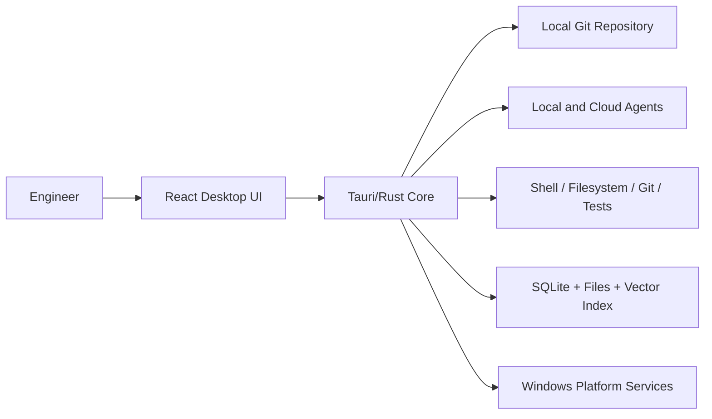
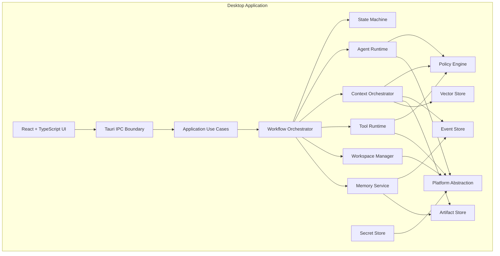
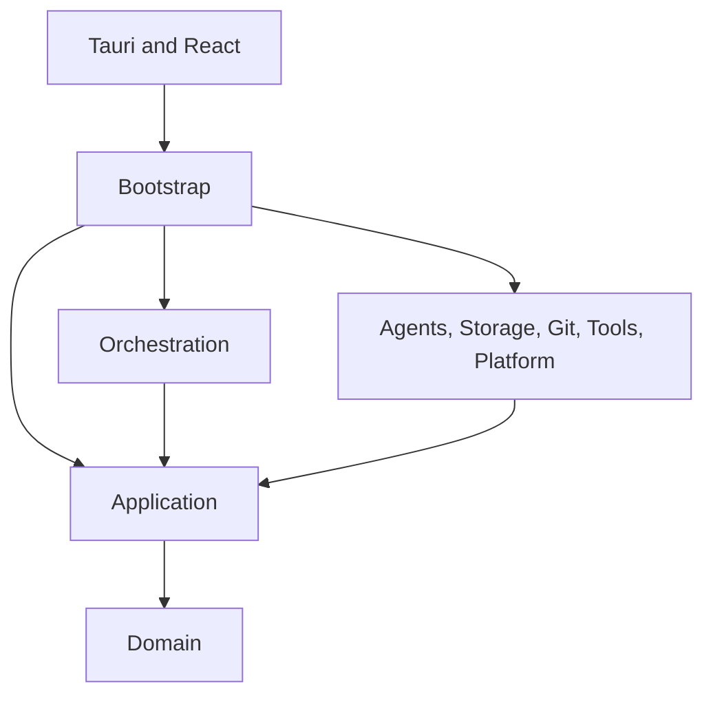
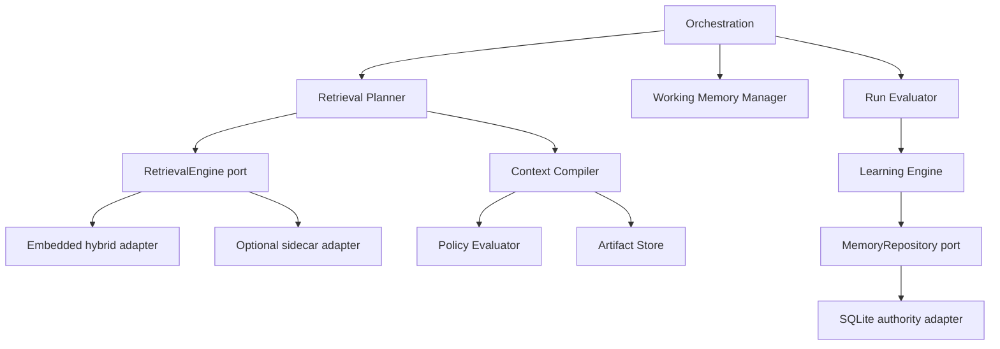

# System Architecture

## 1. Architectural style

The system uses a hybrid architecture:

- a deterministic workflow state machine controls lifecycle and approval gates;
- application use cases own commands, ports, and transaction boundaries;
- an orchestrator coordinates agents and services inside each phase;
- immutable events provide auditability and recovery;
- domain services communicate through explicit commands and events;
- provider-specific integrations are isolated behind adapters;
- persistent user data remains local.

This avoids two extremes: a rigid hard-coded pipeline that cannot adapt to task needs, and an unconstrained AI supervisor that is difficult to predict, secure, or resume.

## 2. Context diagram



## 3. Container architecture



## 4. Rust module boundaries

Recommended workspace structure:

```text
crates/
├── domain/
│   ├── task
│   ├── workflow
│   ├── agent
│   ├── message
│   ├── context
│   ├── policy
│   ├── tool
│   └── artifact
├── application/
│   ├── use_cases
│   ├── input_ports
│   ├── output_ports
│   └── dto
├── orchestration/
├── agent-protocol/
├── agent-runtime/
├── context-engine/
├── memory-engine/
├── policy-engine/
├── tool-runtime/
├── workspace-manager/
├── storage-sqlite/
├── storage-files/
├── vector-store-embedded/
├── git-adapter/
├── platform-core/
├── platform-windows/
├── bootstrap/
└── tauri-app/
```

Rules:

- `domain` contains pure policy and state-transition rules. It contains no
  Tauri, async runtime, database, provider, shell, or OS code.
- `application` contains one use case per user-meaningful operation and owns the
  output ports needed by those use cases.
- `orchestration` implements application coordination policy and depends only
  on `domain` and application ports, never concrete adapters.
- provider adapters depend on `agent-protocol`, not the orchestrator.
- storage, process, Git, policy, and agent crates implement application output
  ports.
- Windows-specific PTY and process code lives only in `platform-windows`.
- UI receives DTOs through Tauri commands and events, never direct database handles.
- `bootstrap` is the sole composition root. It constructs concrete adapters and
  injects them into application use cases.
- CI rejects dependency edges that violate the following graph or introduce a
  crate cycle.



The arrows above represent source-code dependencies. Runtime control may flow
outward through interfaces defined by `application`.

## 5. Core interfaces

```rust
#[async_trait]
pub trait AgentRuntime: Send + Sync {
    async fn list_agents(&self) -> Result<Vec<AgentDescriptor>>;
    async fn start_run(&self, request: AgentRunRequest) -> Result<AgentRunHandle>;
    async fn send(&self, run_id: RunId, message: AgentInput) -> Result<()>;
    async fn cancel(&self, run_id: RunId) -> Result<()>;
}

#[async_trait]
pub trait EventStore: Send + Sync {
    async fn append(&self, stream: StreamId, expected: ExpectedVersion, events: Vec<NewEvent>) -> Result<AppendResult>;
    async fn load(&self, stream: StreamId, from: Sequence) -> Result<Vec<StoredEvent>>;
}

#[async_trait]
pub trait ArtifactStore: Send + Sync {
    async fn put(&self, artifact: NewArtifact) -> Result<ArtifactRef>;
    async fn read(&self, reference: &ArtifactRef) -> Result<ArtifactContent>;
}

#[async_trait]
pub trait RetrievalEngine: Send + Sync {
    async fn index(&self, request: IndexRequest) -> Result<IndexReceipt>;
    async fn retrieve(&self, request: RetrievalRequest) -> Result<RetrievalResult>;
    async fn invalidate(&self, request: InvalidationRequest) -> Result<InvalidationReceipt>;
    async fn health(&self) -> Result<RetrievalHealth>;
}

#[async_trait]
pub trait MemoryRepository: Send + Sync {
    async fn propose(&self, proposal: MemoryProposal) -> Result<MemoryProposalId>;
    async fn transition(&self, command: MemoryTransition) -> Result<MemoryReceipt>;
    async fn query_active(&self, query: ActiveMemoryQuery) -> Result<Vec<MemoryRecord>>;
}

#[async_trait]
pub trait ContextCompiler: Send + Sync {
    async fn compile(&self, request: ContextCompileRequest) -> Result<ContextPackage>;
    async fn supplement(&self, request: ContextSupplementRequest) -> Result<ContextSupplement>;
}

#[async_trait]
pub trait RunEvaluator: Send + Sync {
    async fn evaluate(&self, input: EvaluationInput) -> Result<RunEvaluation>;
}

#[async_trait]
pub trait LearningEngine: Send + Sync {
    async fn extract(&self, input: LearningInput) -> Result<Vec<MemoryProposal>>;
}

#[async_trait]
pub trait PolicyEvaluator: Send + Sync {
    async fn evaluate(&self, request: PolicyRequest) -> Result<PolicyDecision>;
}

#[async_trait]
pub trait ToolExecutor: Send + Sync {
    async fn execute(&self, request: AuthorizedToolRequest) -> Result<ToolExecutionResult>;
}
```

These are application output ports, not domain entities. Every method returns a
typed error that includes retryability and safe user-facing classification.
Concrete construction belongs only in `bootstrap`.

## 6. Command and event flow

Domain commands request state changes. Domain events record completed state changes.

Example:

```text
Command: StartIndependentAnalysis
  → validate current workflow state
  → select eligible agents
  → persist AnalysisStarted
  → dispatch agent runs

Agent result arrives
  → persist AgentMessageCreated
  → persist AgentRunCompleted
  → when completion criteria are met, persist AnalysisCompleted
```

External side effects follow an outbox-style pattern:

1. Persist intent and workflow event in one local transaction.
2. A dispatcher claims the intent with a lease and fencing token.
3. The dispatcher performs the side effect.
4. Persist completion or failure with authoritative evidence.
5. On restart, reconcile incomplete side effects. Retry only when the operation
   contract explicitly declares idempotency.

This prevents silent loss between state persistence and process execution.
It does not provide an atomic transaction across SQLite, Git, processes, and the
filesystem; the reconciliation rules are defined in
[Crash consistency and recovery](15-crash-consistency-recovery.md).

## 7. Process model

The Tauri process hosts the Rust core. External agents and tools execute as child processes or remote API calls.

### Local process types

- native protocol agents through stdio/NDJSON;
- user terminals through ConPTY;
- future legacy CLI adapters through PTY only inside an approved isolated
  worker;
- local model servers such as Ollama-compatible endpoints;
- shell commands inside the task worktree;
- optional embedded index workers.

### Isolation

Lifecycle and defense-in-depth controls:

- dedicated Git worktree;
- restricted working directory;
- environment-variable filtering;
- command allow/deny rules;
- Windows Job Objects for process-tree termination and resource limits;
- ConPTY for user terminals and future isolated interactive CLI adapters;
- no inherited secrets unless explicitly mapped.

These controls do not prevent a process running as the user from directly
reading files, opening network connections, accessing the registry, or using
credential APIs. Therefore an untrusted agent process receives neither the
repository path nor an inherited user shell. It receives context by value and
uses the brokered protocol. External processes that require direct repository
access are disabled in MVP until an `isolated_worker` implementation passes the
acceptance suite in [Trust and sandbox model](13-trust-sandbox-model.md).

## 8. Concurrency model

Parallelism is allowed for read-only phases and verifier tasks. Write ownership is exclusive.

Concurrency controls:

- one workflow coordinator lock per task;
- one durable writable executor lease per worktree;
- monotonically increasing fencing tokens checked by every write-capable tool;
- optimistic concurrency on event stream versions;
- idempotency keys for agent runs and tool requests;
- bounded queues for streamed messages;
- cancellation tokens propagated to child processes and API calls.

## 9. Failure domains

Each failure is isolated and classified:

| Failure | Containment |
|---|---|
| One agent fails | Retry, replace agent, or continue with reduced quorum |
| Vector index unavailable | Fall back to file and event retrieval |
| Cloud API unavailable | Pause or select local/alternate agent |
| Tool command fails | Persist output and enter repair or blocked state |
| UI crashes | Rust core persists state; app reconstructs view on restart |
| Child process hangs | Timeout, terminate process tree, record interrupted result |
| Event append conflict | Reload stream and re-evaluate transition |
| Worktree corruption | Stop writes, preserve evidence, require recovery action |
| External workspace mutation | Revoke lease, invalidate approvals, enter `WorkspaceDirty` |
| Artifact/metadata mismatch | Reconcile intent journal; quarantine unverifiable bytes |
| Stale executor request | Reject by fencing token without performing the side effect |

## 10. Architecture constraints

- No orchestration rule may inspect provider names to decide behavior.
- No model output may directly perform a workflow transition.
- No mutable in-memory state may be the sole copy of task progress.
- No artifact reference may omit a content hash.
- No context package may omit provenance and policy decision metadata.
- No command may execute outside the task worktree unless explicitly approved.
- No raw command string is parsed to infer safety. Structured executable, argv,
  cwd, environment, network, timeout, and expected-write fields are evaluated.
- No final commit may be created from a mutable worktree snapshot. The approved
  Git tree ID is the commit input.
- No application or infrastructure type is constructed inside `domain`,
  `application`, or `orchestration`; `bootstrap` is the only composition root.

## 10.1 Cognitive subsystem

The v4 cognitive subsystem is an application capability, not a provider-owned agent feature.



Dependency rules:

- orchestration depends on application-owned cognitive ports;
- retrieval adapters cannot call workflow mutation APIs;
- the embedded adapter is a reviewed `core_adapter`; an external retrieval sidecar defaults to `brokered_process` and receives no repository path, SQLite handle, or Artifact Store capability;
- the Context Compiler re-reads authoritative bytes instead of trusting returned engine content;
- the Memory Repository owns lifecycle transitions, while the Learning Engine may only propose;
- evaluation and reflection remain separate so an agent cannot grade its own result into active memory;
- all concrete construction remains in `bootstrap`.

Recommended Rust modules:

```text
src/
├── domain/cognition/
│   ├── memory.rs
│   ├── working_memory.rs
│   ├── evaluation.rs
│   └── invariants.rs
├── application/cognition/
│   ├── retrieval_plan.rs
│   ├── compile_context.rs
│   ├── record_observation.rs
│   ├── evaluate_run.rs
│   └── propose_lessons.rs
├── ports/
│   ├── retrieval_engine.rs
│   ├── memory_repository.rs
│   ├── context_compiler.rs
│   ├── run_evaluator.rs
│   └── learning_engine.rs
└── adapters/
    ├── retrieval_embedded/
    ├── retrieval_sidecar/
    └── sqlite_memory/
```

Vector and graph primitives are private dependencies of a `RetrievalEngine` adapter and are never consumed directly by orchestration.

## 10.2 Cognitive failure domains

| Failure | Required behavior |
|---|---|
| Vector index unavailable | Continue exact/keyword retrieval and mark degraded branch |
| Graph stale | Exclude stale graph evidence and schedule rebuild |
| Reranker unavailable | Use deterministic rank fusion |
| Sidecar crashes | Terminate request, preserve trace, retry only if idempotent |
| Learning extraction fails | Complete task without creating memory proposals |
| Evaluation unavailable | Do not pass quality gate that requires it |
| Memory evidence becomes stale | Remove from active retrieval; create and verify a new memory version before reuse |
| Context supplement exceeds budget | Return typed budget denial without truncating unknown suffix |

## 11. v3 authority topology and commit barrier

Module boundaries do not by themselves prove authority boundaries. Runtime composition MUST enforce this topology:

1. only the storage adapter owns the authoritative SQLite connection;
2. only the capability broker owns authoritative repository, Git-ref, and promoted-filesystem handles;
3. workers receive private per-attempt staging/worktrees and opaque capability identifiers, never an ambient writable shared-worktree handle;
4. lease grant/transfer and external promotion share the same bounded per-task barrier;
5. inside the barrier the broker rechecks `(taskId, holderRunId, active lease, fencingToken, operationIntentId)` immediately before the external commit point;
6. typed effect evidence is persisted against the exact operation attempt using compare-and-set semantics;
7. crashes between effect and evidence are reconciled by querying the resource, never by blind retry.

The bootstrap module is therefore both the dependency composition root and the runtime capability root. A compile-time dependency DAG is necessary but not sufficient; denied-capability integration tests must prove that UI, adapters, and workers cannot construct authoritative handles.
