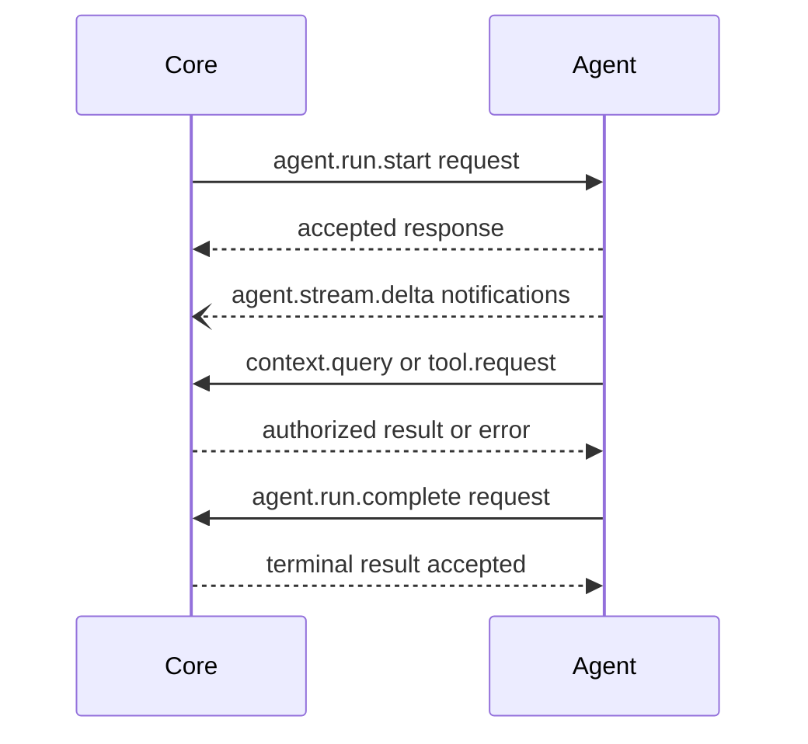

# Open Agent Protocol v1

## 1. Purpose and trust model

The protocol lets a provider adapter or external agent participate without
linking provider-specific behavior into application use cases. The protocol is
bidirectional JSON-RPC 2.0: the core can start or cancel a run, while an agent
can request context, tools, or a specialist.

Protocol compatibility does not imply trust. The core binds every connection to
the executable, manifest, launch record, effective trust tier, and negotiated
capabilities. An agent-supplied ID, timestamp, cost, tool result, or claim is
untrusted until the core records or verifies it.

The machine-readable payload contract is
[`schemas/agent-protocol.v1.schema.json`](schemas/agent-protocol.v1.schema.json).
Schema-valid fixtures are in [`schemas/examples`](schemas/examples).

## 2. Transport profile

MVP transport is UTF-8 newline-delimited JSON-RPC 2.0 over a child process's
stdin/stdout.

Rules:

- stdout contains protocol frames only;
- stderr contains bounded diagnostic text and is never parsed as protocol;
- one complete JSON object occupies one line;
- embedded line breaks are JSON-escaped;
- the default maximum frame is 8 MiB;
- both peers honor operating-system pipe backpressure;
- request IDs are strings and unique for the connection;
- core-originated IDs start with `core:` and agent-originated IDs with `agent:`;
- a message without `id` is a notification and must not receive a response;
- malformed JSON, duplicate terminal messages, or a stream sequence gap fails
  the affected run;
- large content uses opaque authorized references rather than oversized frames.

HTTP and WebSocket transports may be added later but must preserve the same
method semantics, identity binding, limits, and schemas.

## 3. Method ownership

| Method | Initiator | Kind | Meaning |
|---|---|---|---|
| `initialize` | Core | Request | Negotiate one protocol version and capabilities |
| `initialized` | Core | Notification | Confirm that initialization state is active |
| `agent.run.start` | Core | Request | Ask the agent to accept a stable run ID |
| `agent.run.cancel` | Core | Request | Request cancellation and acknowledgement |
| `agent.run.complete` | Agent | Request | Submit the single terminal result |
| `agent.stream.delta` | Agent | Notification | Emit presentation-only streaming content |
| `context.query` | Agent | Request | Ask the core for additional authorized context |
| `tool.request` | Agent | Request | Ask the core to evaluate and execute a tool |
| `specialist.request` | Agent | Request | Ask the orchestrator for another capability |
| `agent.heartbeat` | Agent | Notification | Report liveness for a long-lived process |
| `shutdown` | Core | Request | Ask the process to shut down cleanly |
| `exit` | Core | Notification | End the protocol session after shutdown |

Every request receives exactly one success or error response. A response only
confirms the corresponding request; it is not a workflow transition.

## 4. Initialization

### 4.1 Core request

```json
{
  "jsonrpc": "2.0",
  "id": "core:1",
  "method": "initialize",
  "params": {
    "protocolVersions": ["1.0"],
    "client": {
      "name": "local-agent-terminal",
      "version": "0.2.0"
    },
    "transport": {
      "type": "stdio-ndjson",
      "maxFrameBytes": 8388608
    },
    "features": [
      "streaming",
      "context-query",
      "tool-request",
      "specialist-request"
    ],
    "launchBinding": {
      "connectionId": "conn-71",
      "manifestDigest": "sha256:...",
      "executableDigest": "sha256:...",
      "trustTier": "brokered_process"
    }
  }
}
```

### 4.2 Agent response

```json
{
  "jsonrpc": "2.0",
  "id": "core:1",
  "result": {
    "protocolVersion": "1.0",
    "agent": {
      "id": "qwen-coder-local",
      "displayName": "Qwen Coder Local",
      "implementationVersion": "0.4.0"
    },
    "capabilities": {
      "roles": ["analyst", "critic", "executor", "reviewer"],
      "skills": ["code-analysis", "implementation", "testing"],
      "streaming": true,
      "contextQuery": true,
      "toolRequests": true,
      "specialistRequests": true,
      "maxConcurrentRuns": 1,
      "maxContextTokens": 32768
    }
  }
}
```

The core rejects a response that selects an unoffered protocol version, exceeds
manifest limits, or requests a higher trust tier. Capabilities may be reduced
by policy but never expanded by handshake.

After validation the core emits:

```json
{
  "jsonrpc": "2.0",
  "method": "initialized",
  "params": {
    "connectionId": "conn-71",
    "effectiveCapabilitiesDigest": "sha256:..."
  }
}
```

## 5. Manifest

```yaml
schema_version: 1
id: qwen-coder-local
display_name: Qwen Coder Local
transport:
  type: stdio-ndjson
  executable: C:\Program Files\AgentTerminal\agents\qwen-agent.exe
  args: [serve, --protocol, jsonrpc]
capabilities:
  roles: [analyst, critic, executor, reviewer]
  skills: [code-analysis, implementation, testing]
limits:
  max_concurrent_runs: 1
  max_context_tokens: 32768
  max_frame_bytes: 8388608
security:
  requested_trust_tier: brokered_process
  network: denied
  filesystem: brokered
  shell: brokered
health:
  startup_timeout_ms: 15000
  heartbeat_interval_ms: 30000
```

The executable is launched directly from a canonical absolute path, never
through shell lookup. The core records the executable and manifest digests for
each connection. A manifest is a permission request, not an authorization.

## 6. Run lifecycle



`agent.run.start` returns promptly. It does not keep one JSON-RPC request open
for the duration of the model run.

```json
{
  "jsonrpc": "2.0",
  "id": "core:8",
  "method": "agent.run.start",
  "params": {
    "runId": "run-238",
    "idempotencyKey": "task-1:analysis:qwen:1",
    "taskId": "task-1",
    "role": "critic",
    "objective": "Review the authentication proposal for security and codebase fit.",
    "contextPackage": {
      "packageId": "ctx-501",
      "contentDigest": "sha256:...",
      "manifestRef": "artifact:ctx-501",
      "inlineSummary": "..."
    },
    "permissions": {
      "contextQuery": true,
      "toolRequest": true,
      "writeFiles": false
    },
    "responseSchema": "agent-message.v1",
    "limits": {
      "deadline": "2026-07-23T13:30:00Z",
      "maxOutputTokens": 8000,
      "maxToolRequests": 8
    }
  }
}
```

Acceptance:

```json
{
  "jsonrpc": "2.0",
  "id": "core:8",
  "result": {
    "accepted": true,
    "runId": "run-238"
  }
}
```

At most one `agent.run.complete` request is accepted for a run. Connection loss
before an accepted terminal request marks the run `interrupted`. MVP restarts
the work as a new run with `supersedesRunId`; it does not pretend to resume an
unrecoverable model generation.

## 7. Streaming

```json
{
  "jsonrpc": "2.0",
  "method": "agent.stream.delta",
  "params": {
    "runId": "run-238",
    "sequence": 17,
    "channel": "content",
    "delta": "The main risk is"
  }
}
```

Sequence starts at `1` and increases by one. A duplicate with identical bytes
is ignored; a conflicting duplicate or gap fails the stream. Stream deltas are
untrusted presentation data. They are not evidence, project memory, or the
authoritative run result.

The core enforces per-run byte and token budgets. When a limit is reached it
cancels the run rather than dropping an unknown suffix and accepting a
potentially malformed final result.

## 8. Context requests

Because the agent expects a result, `context.query` is a JSON-RPC request and
must include `id`.

```json
{
  "jsonrpc": "2.0",
  "id": "agent:12",
  "method": "context.query",
  "params": {
    "runId": "run-238",
    "queryId": "cq-12",
    "query": "Previous verified decisions about authentication persistence",
    "scopes": ["project-memory", "decisions", "repository"],
    "maxItems": 12,
    "maxTokens": 8000
  }
}
```

The response returns an immutable supplement:

```json
{
  "jsonrpc": "2.0",
  "id": "agent:12",
  "result": {
    "supplementId": "ctx-supp-44",
    "contentDigest": "sha256:...",
    "items": [],
    "provenance": [],
    "redactions": [],
    "policyDecisionIds": ["pol-41", "pol-42"]
  }
}
```

Opaque references never reveal an operating-system path. Reads of referenced
content remain mediated and scoped to the run.

## 9. Tool requests

```json
{
  "jsonrpc": "2.0",
  "id": "agent:77",
  "method": "tool.request",
  "params": {
    "runId": "run-238",
    "requestId": "tool-77",
    "planStepId": "step-4",
    "executorFencingToken": null,
    "tool": "git.diff",
    "arguments": {
      "path": "src/auth"
    },
    "reason": "Verify whether the proposed change matches the approved scope"
  }
}
```

Read-only requests omit the fencing token. Every write-capable request must
carry the current token and is rejected if the lease changed.

Possible results:

- success with result artifact references;
- denied with matched policy rules;
- approval required with an immutable approval request ID;
- redacted success;
- typed tool error.

Process execution uses structured arguments:

```json
{
  "tool": "process.exec",
  "arguments": {
    "executable": "toolchain:cargo",
    "argv": ["test", "--workspace", "--locked"],
    "cwd": "worktree:",
    "environmentProfile": "rust-build-no-secrets",
    "network": "denied",
    "timeoutMs": 600000,
    "expectedWrites": ["target/**"]
  }
}
```

`shell.raw` is a separate tool classification. A free-form string passed to
`process.exec` is invalid and is not repaired or reinterpreted as shell syntax.

## 10. Specialist requests

```json
{
  "jsonrpc": "2.0",
  "id": "agent:91",
  "method": "specialist.request",
  "params": {
    "runId": "run-238",
    "capability": "database-migration-review",
    "reason": "The proposal introduces a new token-family table.",
    "requiredContext": ["artifact:proposal-3", "source:schema.sql"]
  }
}
```

The orchestrator may approve, reject, reuse a participant, or request user
approval. The response never grants the requesting agent additional access.
Specialist depth, count, cost, and context are bounded by the parent task.

## 11. Final message and evidence

The agent submits the terminal result in `agent.run.complete`:

```json
{
  "jsonrpc": "2.0",
  "id": "agent:100",
  "method": "agent.run.complete",
  "params": {
    "runId": "run-238",
    "status": "succeeded",
    "message": {
      "messageId": "msg-900",
      "type": "critique",
      "replyTo": "msg-877",
      "threadId": "thread-auth-security",
      "content": "The proposal does not revoke the token family after reuse detection.",
      "claims": [
        {
          "claimId": "claim-44",
          "text": "Current code has no token-family invalidation path.",
          "evidenceRefs": [
            {
              "sourceType": "repository",
              "sourceId": "src/auth/token_service.rs",
              "revision": "worktree:task-1:abc123",
              "contentDigest": "sha256:...",
              "startLine": 88,
              "endLine": 140
            }
          ],
          "confidence": 0.88
        }
      ]
    },
    "usage": {
      "inputTokens": 12000,
      "outputTokens": 1800,
      "providerReportedCost": 0.08
    }
  }
}
```

The core:

1. binds the message to the authenticated connection and run;
2. assigns the authoritative receipt timestamp and event sequence;
3. validates every evidence reference and marks missing or stale evidence;
4. records provider-reported usage separately from core estimates;
5. persists the terminal event before acknowledging it.

Agent-supplied `authorAgentId` and authoritative timestamps are intentionally
absent from the payload.

## 12. Cancellation and shutdown

Cancellation is a request:

```json
{
  "jsonrpc": "2.0",
  "id": "core:30",
  "method": "agent.run.cancel",
  "params": {
    "runId": "run-238",
    "reason": "user_cancelled",
    "deadlineMs": 5000
  }
}
```

The agent acknowledges whether cancellation was accepted. If it does not stop
by the deadline, the core terminates the process tree and records the run as
`terminated`, not `cancelled_cleanly`.

For normal process shutdown the core sends `shutdown`, waits for its response,
then sends the `exit` notification. Unexpected process exit interrupts every
active run on that connection.

## 13. Errors

```json
{
  "jsonrpc": "2.0",
  "id": "core:8",
  "error": {
    "code": -32031,
    "message": "Context window exceeded",
    "data": {
      "category": "context_too_large",
      "retryable": true,
      "suggestedMaxTokens": 24000
    }
  }
}
```

Reserved application error categories:

- `protocol_incompatible`
- `invalid_request`
- `identity_binding_failed`
- `provider_unavailable`
- `rate_limited`
- `context_too_large`
- `cancelled`
- `timeout`
- `policy_denied`
- `approval_required`
- `stale_fencing_token`
- `malformed_structured_output`
- `output_limit_exceeded`
- `internal_agent_failure`

Only the core classifies whether a workflow retry is safe.

## 14. Compatibility and conformance

- a major protocol mismatch fails initialization;
- a minor version may add optional fields and methods;
- unknown optional fields are ignored and preserved when proxying;
- unknown required capabilities fail before dispatch;
- payload schema versions evolve independently but must be declared;
- every adapter must pass the protocol conformance suite;
- an adapter cannot claim tool execution without a matching core tool receipt;
- evidence references must resolve to the recorded revision or be marked
  external and unverified;
- context input is reconstructible, but model output is not claimed to be
  deterministic or reproducible.

The run record captures protocol version, manifest and executable digests,
adapter version, provider/model identifier, generation parameters, prompt
template version, response schema version, policy snapshot, and exact context
package digest.
