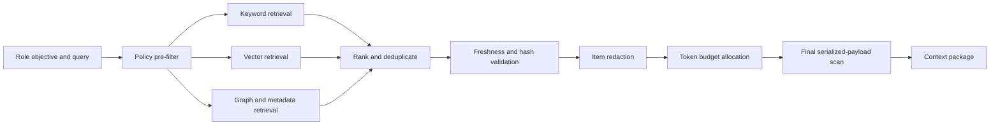

# Context and Memory Architecture

## 1. Design goal

Provide each agent with the smallest complete context needed for its assigned objective while preserving provenance, policy compliance, freshness, and reproducibility.

Here, reproducibility means that the exact effective input can be reconstructed
and audited. It does not mean that a probabilistic provider will emit the same
response again.

## 2. Sources of truth

### Authoritative

- repository files;
- immutable workflow events;
- hashed task artifacts;
- verified project-memory entries;
- recorded tool outputs.

### Non-authoritative indexes

- vector embeddings;
- keyword indexes;
- summaries generated by models;
- cached repository maps.

A vector hit or summary must always point back to authoritative material.
Agreement among models is not an authoritative source.

## 3. Context layers

### 3.1 Task layer

- user request;
- accepted scope;
- risk class;
- workflow phase;
- budget and policy constraints.

### 3.2 Shared discussion layer

- current shared summary;
- accepted decisions;
- unresolved objections;
- high-value cross-thread conclusions.

### 3.3 Active thread layer

- target message;
- direct replies;
- relevant evidence requests;
- bounded parent context.

### 3.4 Repository layer

- repository map;
- selected files and chunks;
- dependency and build metadata;
- current worktree diff;
- test configuration.

### 3.5 Project memory layer

- approved architectural decisions;
- validated conventions;
- confirmed build and test commands;
- resolved bugs and root causes;
- known constraints.

### 3.6 Agent-private temporary layer

Private scratch data is scoped to one agent run or session. It is not shared or promoted unless the agent emits a structured artifact and the orchestrator accepts it.

## 4. Context package

```json
{
  "packageId": "ctx-501",
  "taskId": "task-1",
  "agentId": "security-agent",
  "role": "critic",
  "objective": "Review the approved proposal for security risks.",
  "createdAt": "2026-07-23T13:20:00Z",
  "budget": {
    "maxTokens": 32000,
    "reservedResponseTokens": 8000
  },
  "task": {},
  "sharedSummary": {},
  "activeThread": [],
  "acceptedDecisions": [],
  "unresolvedObjections": [],
  "artifacts": [],
  "retrievedChunks": [],
  "permissions": {},
  "provenance": [],
  "redactions": [],
  "policyDecisionIds": [],
  "policySnapshotDigest": "sha256:...",
  "promptTemplateVersion": "critic.v3",
  "retrievalPipelineVersion": "retrieval.v2",
  "contentHash": "sha256:..."
}
```

Every package is immutable and its exact effective bytes are stored as a
content-addressed artifact, unless a secret-handling rule requires encrypted
restricted storage. Metadata alone is insufficient. This makes the input
reconstructible and explains what the agent actually saw.

## 5. Retrieval pipeline



### Retrieval ranking signals

- direct file path or symbol match;
- semantic similarity;
- relationship to active task files;
- recency and current content hash;
- verified project-memory status;
- cited by accepted decisions;
- agent role relevance;
- sensitivity and allowed disclosure;
- redundancy penalty.

## 6. Chunking rules

Repository chunks should align with semantic boundaries when possible:

- function, method, class, type, configuration section, test case;
- preserve file path, symbol, line range, language, hash, and commit/worktree identity;
- avoid combining unrelated symbols;
- maintain limited parent context for readability;
- re-index only changed sources.
- apply the same sensitivity classifier and secret scanner before chunk content
  reaches keyword, graph, embedding, or cache indexes;
- use a local embedding implementation by default. A remote embedding provider
  is an external disclosure and follows the same policy path as a cloud agent.

Example metadata:

```json
{
  "chunkId": "chunk-934",
  "sourceId": "worktree:task-1:src/auth/token.ts",
  "path": "src/auth/token.ts",
  "symbol": "rotateRefreshToken",
  "startLine": 45,
  "endLine": 103,
  "language": "typescript",
  "contentHash": "sha256:...",
  "worktreeRevision": "abc123",
  "sensitivity": "internal-code",
  "allowedAgentClasses": ["local", "approved-cloud"]
}
```

## 7. Freshness and invalidation

A retrieved chunk is stale when:

- source hash differs;
- worktree revision differs and the affected range changed;
- artifact has been superseded;
- event or memory entry was retracted;
- policy classification changed.

Stale content is excluded by default. Re-indexing is incremental and driven by filesystem change events plus explicit verification before final review.

## 8. Summarization strategy

Summaries reduce context size but cannot replace evidence.

Three summary levels:

1. **Thread summary:** compressed conversation with unresolved issues preserved.
2. **Phase summary:** outcome, evidence, dissent, and next actions.
3. **Project memory:** only validated long-term knowledge.

Every summary stores:

- source event range;
- summarizer agent and model;
- creation timestamp;
- content hash;
- list of unresolved objections;
- confidence and verification state.

## 9. Memory promotion

A candidate may become project memory only when one condition is met:

- user explicitly approves it;
- deterministic tooling verifies it;
- it is part of an approved and committed change;
- a human-approved decision cites authoritative source evidence whose hashes
  still match.

Multiple agents agreeing may increase the priority of a candidate for
verification, but cannot mark it verified.

Promotion states:

```text
candidate → verified → approved → active
candidate → rejected
active → superseded
active → retracted
```

## 10. File layout

```text
<artifact-root>/
├── project.json
├── policies/
├── project-memory/
│   ├── decisions/
│   ├── conventions/
│   ├── known-issues/
│   └── commands/
├── tasks/
│   └── <task-id>/
│       ├── task.json
│       ├── context-packages/
│       ├── proposals/
│       ├── discussions/
│       ├── plans/
│       ├── patches/
│       ├── test-results/
│       ├── logs/
│       └── final/
└── indexes/
```

Large content remains in files. SQLite contains searchable metadata, event streams, references, and status.

`<artifact-root>` defaults to application data. A project-local
`.ai-workspace` is opt-in, automatically excluded from Git, and never placed
inside the writable task worktree.

## 11. Redaction

Classification and secret scanning execute before indexing. Redaction executes
again after retrieval and a final time over the exact serialized outbound
payload. Rules include:

- deny known secret files such as `.env`, key stores, credentials, and private certificates;
- redact matching secret patterns;
- replace restricted blocks with stable placeholders;
- preserve enough structure for agent understanding;
- record exactly which rules changed the content;
- prevent the vector index from embedding denied secret content.
- treat filenames, symbol names, repository metadata, and tool output as
  potentially sensitive, not only source bodies;
- bind the final outbound digest to the policy snapshot and redaction report.

## 12. Context budget allocation

A default allocation for a 32k context window:

| Segment | Budget |
|---|---:|
| Instructions and role | 8% |
| Task and constraints | 12% |
| Shared decisions and objections | 15% |
| Active thread | 20% |
| Repository evidence | 35% |
| Safety reserve | 10% |

The allocation is role-sensitive. A verifier receives more evidence; a lead receives more discussion and decision history.

## 13. Repository graph

Graph retrieval is optional and implements an application-owned
`RepositoryGraph` port. MVP may store symbol and dependency edges in SQLite.
Every node and edge carries source revision and content hashes and is discarded
when stale. If no graph adapter is configured, the retrieval pipeline omits the
graph branch; it must not imply an undeclared fourth persistent store.

## 14. Run reconstruction record

The context package is paired with a run configuration containing:

- protocol, adapter, executable, and manifest digests;
- provider and model identifier as reported at execution time;
- generation parameters and response schema;
- system and role prompt template versions;
- policy and redaction snapshot;
- retrieval, ranking, chunker, embedding, and tokenizer versions;
- exact tool schemas available to the run;
- authoritative core receipt timestamps.

This record supports audit and replay experiments without promising
deterministic model output.
