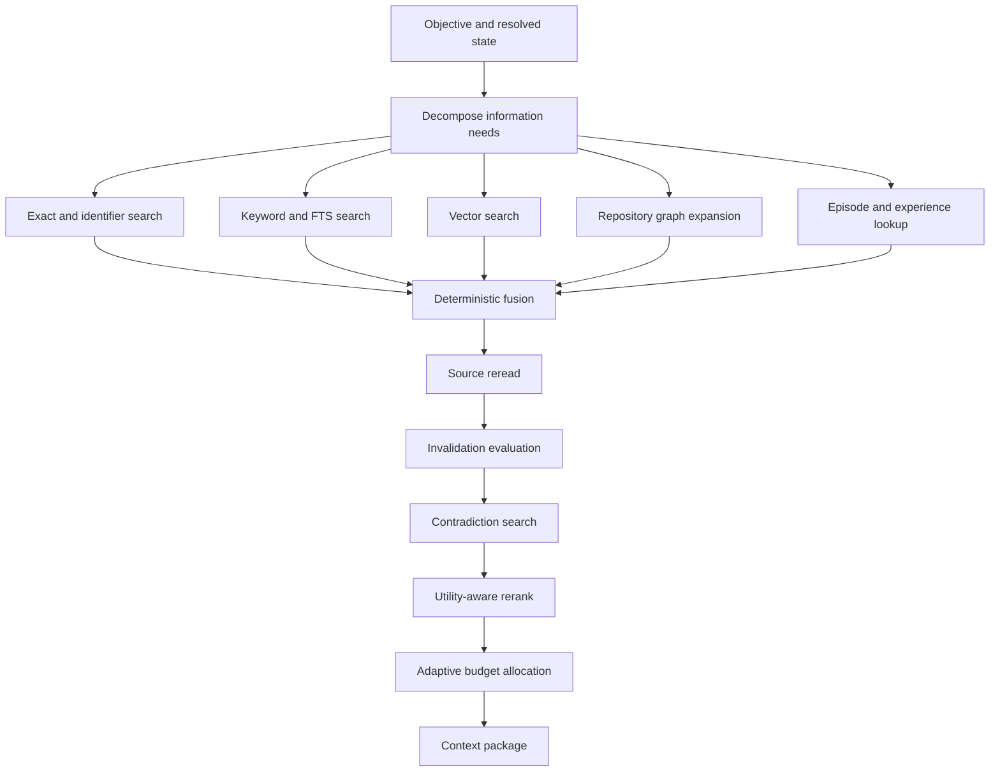

# Cognitive Context and Memory Architecture v4.1.1

## 1. Purpose

The cognitive subsystem improves agent quality by supplying the smallest sufficient authoritative context, preserving useful verified experience, and preventing repeated mistakes without turning model output or vector similarity into authority.

The subsystem is designed around one question:

> What information does this task need now, which source is authoritative, and what measured value does prior experience add?

It is not a conversation archive, an autonomous knowledge base, or a mechanism for bypassing repository, policy, approval, or verification controls.

The design preserves:

- authoritative provenance;
- exact state precedence;
- project and task isolation;
- route-complete policy enforcement and redaction;
- exact reconstruction of context packages;
- explicit uncertainty and contradiction;
- typed, executable invalidation;
- replaceable retrieval and index implementations;
- measured contribution before memory expansion;
- human or deterministic verification before durable learning.

Reproducibility means that the exact effective input, state-resolution receipt, retrieval trace, budget decision, policy decisions, source revisions, and memory versions can be reconstructed. It does not mean that a probabilistic provider must emit identical output.

## 2. Cognitive lifecycle

```mermaid
flowchart LR
    O[Observe objective and task state] --> SR[Resolve authoritative state]
    SR --> N[Decompose information needs]
    N --> R[Retrieve evidence candidates]
    R --> M[Retrieve eligible experience]
    M --> I[Evaluate invalidation and contradictions]
    I --> B[Allocate adaptive context budget]
    B --> C[Compile smallest sufficient package]
    C --> A[Agent reasons and acts]
    A --> V[Verify outcome]
    V --> E[Evaluate contribution and quality]
    E --> P[Propose state or memory changes]
    P --> S[Shadow-test and review]
    S --> L[Promote, consolidate, supersede, or reject]
    L --> O
```



Four barriers are mandatory:

1. retrieval candidates are not facts;
2. experience memory cannot override higher-precedence current state;
3. reflection creates proposals, not active authority;
4. utility scores and similarity scores cannot change lifecycle state directly.

For compatibility with the v4.0 assurance contract, the barriers are also stated verbatim: **retrieval results are candidates**; **agent reflection produces proposals**; and **Model agreement and self-reported success are never sufficient** for promotion, verification, or lifecycle change.

## 3. Three-store model

### 3.1 Authoritative State Store

The State Store contains current, structured values needed to resolve the present task. Examples include:

- the latest explicit user instruction;
- task-specific overrides;
- approved architecture decisions;
- project configuration;
- explicit user preferences;
- bounded inferred preferences.

State is not retrieved through semantic similarity. It is resolved deterministically by key, scope, validity, and precedence.

Precedence is fixed:

| Rank | Authority kind | Example |
|---:|---|---|
| 600 | `current_instruction` | “For this answer, use Vietnamese.” |
| 500 | `task_override` | “This migration task is read-only.” |
| 400 | `approved_decision` | Accepted architecture decision |
| 300 | `project_setting` | Repository coding or release policy |
| 200 | `explicit_user_preference` | Stable requested report style |
| 100 | `inferred_preference` | Repeated pattern not explicitly confirmed |

A lower rank never overrides a valid higher rank. Equal-rank divergent values are not silently resolved. The runtime first records an immutable `stateResolutionConflict`; the eventual `stateResolutionReceipt` must carry that exact conflict ID, bind the same candidate set, and be the only resolution receipt for that conflict.

Every resolution emits an immutable `stateResolutionReceipt` containing:

- the state key;
- all considered candidate state IDs;
- the winning state ID;
- the resolution-rule version;
- task and project scope;
- result artifact and digest;
- policy snapshot digest;
- decision time;
- optional explicit conflict ID when the winner resolves a recorded equal-rank conflict.

A new state starts `active`, must already be valid at creation, and receives `endedAt=statusChangedAt` when it becomes superseded, retracted, or expired. Resolution rechecks validity at the receipt timestamp rather than trusting the status label alone.

### 3.2 Evidence Store

The Evidence Store consists of existing authoritative sources:

- repository and worktree files at a bound revision and content hash;
- immutable workflow events and receipts;
- content-addressed artifacts;
- deterministic tool outputs;
- approved decisions;
- verification results.

Indexes, embeddings, summaries, graphs, rankings, and inferred relationships are derived projections. They may be deleted and rebuilt without destroying authority.

### 3.3 Experience Memory Store

The Experience Store contains verified historical knowledge that may help future tasks:

- episodes;
- semantic lessons that are not current state;
- reusable procedures;
- negative memory;
- retained preference history.

New explicit preferences are written to the State Store first. A historical preference memory may remain for audit or learning, but it cannot override the active state-resolution result.

## 4. Memory taxonomy

| Memory type | Purpose | Typical lifetime | Promotion requirement |
|---|---|---:|---|
| Working | Current objective, hypotheses, unknowns, next actions | One run or bounded phase | Never directly promoted |
| Episodic | What happened in a prior task or run | Project retention policy | Verified outcome and summary |
| Semantic | Stable lesson not owned by current state | Until invalidated or superseded | Authoritative evidence |
| Procedural | Reusable method or checklist | Until invalidated or superseded | Evidence plus successful use or user approval |
| Negative | Failed approach, disproven assumption, regression, unsafe action | Until underlying condition changes | Failure or regression evidence |
| Preference history | Historical preference evidence | Scoped retention | Explicit source; active value belongs in State Store |

### 4.1 Working memory

Working memory records:

- objective and acceptance criteria;
- current plan step;
- facts, inferences, and unknowns;
- hypotheses and expected observations;
- evidence requested and received;
- unresolved contradictions;
- next action and stop condition;
- token, time, and tool budget.

Working memory is checkpointed for crash recovery. It is not a durable memory record and cannot be promoted in place.

Recommended hypothesis shape:

```json
{
  "hypothesisId": "h1",
  "statement": "The close regression is caused by DTO-to-SQL identity mismatch",
  "status": "testing",
  "evidenceFor": ["source-chunk-1"],
  "evidenceAgainst": [],
  "expectedObservation": "NUM is passed by the UI but another field is bound in SQL",
  "nextTest": "Trace the API parameter into the command binding",
  "ownerAgentId": "debugger-1"
}
```

### 4.2 Episodic memory

An episode binds:

- task, run, role, and repository revision;
- initial objective and constraints;
- significant observations and actions;
- terminal outcome and verification evidence;
- quality evaluation;
- lessons proposed from the episode.

Raw terminal streams remain referenced artifacts and are not copied into memory by default.

### 4.3 Semantic memory

Semantic memory is reserved for stable, evidence-backed lessons that are not better represented as current state. Examples include a historical architectural constraint or a durable subsystem relationship.

A current version number, active branch, present task permission, or active user instruction belongs in the State Store, not semantic memory.

### 4.4 Procedural memory

A procedure contains:

- applicability conditions;
- required inputs and permissions;
- ordered steps;
- verification checks;
- rollback or stop conditions;
- evidence from prior successful use;
- known exceptions;
- typed invalidation rules.

A procedure never grants tool permissions and cannot override current policy.

### 4.5 Negative memory

Negative memory is retrieved before high-risk planning and implementation. It captures:

- failed approaches and observed failure modes;
- disproven assumptions;
- regression signatures;
- environment incompatibilities;
- unsafe or ineffective commands;
- prior reviewer findings that must not recur.

Negative memory is first-class because preventing a known repeated failure often has greater value than adding another general fact.

## 5. Sources of truth and authority order

Authoritative sources are evaluated in this order:

1. current state-resolution result;
2. repository or worktree source at the bound revision;
3. immutable event, receipt, artifact, tool result, or approved decision;
4. verified active experience memory whose invalidation rules currently pass;
5. non-authoritative derived indexes and summaries.

A derived summary may help locate source evidence, but it cannot overrule the source it summarizes.

## 6. Typed invalidation

### 6.1 Requirement

Every v4.1.1 durable memory proposal contains one or more machine-readable invalidation rules. Natural-language explanation is required for review, but explanation alone is not executable.

Initial rule kinds:

- `source_hash_changed`;
- `source_revision_outside_range`;
- `path_modified`;
- `dependency_version_changed`;
- `schema_version_changed`;
- `test_result_changed`;
- `policy_changed`;
- `time_expired`;
- `manual_revoke`.

Example:

```json
{
  "ruleId": "rule-warning-dto-hash",
  "kind": "source_hash_changed",
  "target": {"sourceId": "src/WarningDto.cs"},
  "expected": {
    "contentHash": "sha256:aaaaaaaaaaaaaaaaaaaaaaaaaaaaaaaaaaaaaaaaaaaaaaaaaaaaaaaaaaaaaaaa"
  },
  "cadence": "before_retrieval",
  "explanation": "Revalidate the procedure when the DTO mapping changes"
}
```

### 6.2 Evaluation

An invalidation evaluation records:

- memory and rule identity;
- task and project scope;
- `passed`, `failed`, or `indeterminate` result;
- evidence artifact and digest;
- evaluation time;
- optional validity deadline.

Before durable experience is included in a context package, every declared rule must have the latest passing evaluation applicable to the current project/task, evaluated no later than retrieval start, and still inside its validity window. An unrelated-task, future, missing, failed, expired, or indeterminate result cannot authorize retrieval.

A stale memory cannot be repaired in place. Reuse requires a new immutable version, fresh evidence, new invalidation results, review, and a supersession relation.

## 7. Context layers

The Context Compiler assembles packages from these layers:

1. **Objective:** request, scope, acceptance criteria, risk, policy, and budgets.
2. **Resolved state:** deterministic current state and resolution receipts.
3. **Task state:** workflow phase, current plan, completed work, checks, and diff.
4. **Shared decisions:** accepted decisions, objections, dissent, and contradictions.
5. **Working memory:** facts, inferences, unknowns, hypotheses, and next action.
6. **Repository evidence:** selected files, symbols, tests, configuration, and graph neighbors.
7. **Experience memory:** eligible verified episodes, semantic lessons, procedures, and negative memory.
8. **Active thread:** target message, bounded parents, replies, and evidence requests.
9. **Private temporary state:** unshared scratch state scoped to one run.

No layer bypasses policy, freshness validation, or final payload scanning.

## 8. Information-need decomposition

Before broad retrieval, the compiler decomposes the objective into explicit information needs:

```json
{
  "needId": "need-1",
  "question": "Which field is the authoritative warning identity?",
  "sourceKinds": ["state", "repository", "decision", "experience-memory"],
  "status": "open"
}
```

Each retrieved item must cover at least one open need, establish a contradiction, or satisfy a required check. Items with no identifiable contribution are excluded from the initial package.

## 9. Retrieval pipeline



### 9.1 Query planning

Queries are source-specific. A single vague semantic query is insufficient.

A retrieval plan may include:

- exact identifiers and paths;
- symbol and call-graph neighbors;
- error strings and test names;
- accepted decisions;
- current state keys;
- prior failures for the same subsystem and task class;
- contradictory versions or claims.

### 9.2 Ranking signals

Ranking may use:

- exact identifier match;
- lexical relevance;
- embedding similarity;
- graph distance;
- scope match;
- authority class;
- freshness and invalidation state;
- contradiction relevance;
- task-class match;
- measured memory utility;
- token cost;
- redundancy penalty.

Similarity alone never determines authority or final inclusion.

### 9.3 Utility-aware reranking

A memory's advisory utility may consider:

```text
utility =
  successful-use contribution
  + evaluator helpfulness
  + repeated-error reduction
  + unique evidence coverage
  - harmful-use penalty
  - token-cost penalty
  - redundancy penalty
  - stale or uncertain penalty
```

The utility projection is rebuildable derived state. It may influence ranking or generate review proposals. It cannot activate, stale, supersede, retract, or delete memory.

### 9.4 Contradiction retrieval

For each high-impact claim, the compiler searches for:

- newer source revisions;
- rejected or superseded decisions;
- failed tests;
- negative memory;
- contradictory active state;
- evidence that narrows applicability.

Unresolved contradictions are included explicitly rather than hidden by summarization.

## 10. Adaptive context budgeting

Static percentages are fallback profiles, not fixed policy.

The allocator considers:

- task class;
- risk level;
- number and importance of open information needs;
- current evidence coverage;
- unresolved contradictions;
- source authority;
- expected marginal utility;
- token and latency cost;
- reserved response and verification capacity.

A budget decision is immutable and includes integer per-layer allocations, allocated total, maximum input budget, reserved output tokens, reserved verification tokens, strategy version, coverage, marginal-utility threshold, stopping reason, evidence digest, and policy snapshot. Allocations plus both reserves cannot exceed the declared maximum.

Typical task behavior:

- compile errors: repository evidence dominates;
- architecture review: decisions and contradictions receive more budget;
- repeated regression: negative and procedural memory receive more budget;
- simple factual change: memory retrieval may be skipped entirely.

## 11. Retrieval stopping rules

Retrieval stops when one of these conditions is true:

- required information needs have sufficient authoritative coverage;
- the remaining marginal expected utility is below token and latency cost;
- policy or task budget is exhausted;
- no eligible candidates remain;
- a blocking contradiction requires user or deterministic resolution.

Filling the model context window is never a goal.

## 12. Cognitive context package v2

A v2 context package includes:

- objective and acceptance criteria;
- resolved state records;
- state-resolution receipt IDs;
- task and working-memory state;
- decomposed information needs;
- retrieval session and source items;
- adaptive budget decision;
- contradictions and required checks;
- permission envelope;
- policy and redaction receipts;
- exact content hash;
- stopping reason.

The manifest and exact effective model-input bytes are separate artifacts. The package is immutable and consumed by exactly one preallocated run. An experience-memory item may enter the package only through the exact selected retrieval candidate from the same preallocated run and package. That candidate must already have passed scope, freshness, hash, status, expiry, and invalidation eligibility checks; a selected candidate from an older run of the same task is not reusable.

## 13. Progressive context

An agent may request additional context only by naming the unmet need:

- a source or symbol;
- related files or graph neighbors;
- previous failures;
- decision history;
- contradiction evidence;
- a specific active state key.

A supplement cannot broaden permissions, project scope, task scope, or parent budget. It receives its own immutable receipt and source trace.

## 14. Reflection and learning

Reflection produces proposals such as:

- a state update;
- an episodic record;
- a semantic lesson;
- a reusable procedure;
- a negative memory;
- a consolidation action.

Reflection may not directly write active state or active memory.

### 14.1 State proposals

A state proposal must identify:

- key and JSON value;
- scope;
- authority kind;
- source evidence;
- validity window;
- superseded record if any.

Inferred preference state uses the lowest precedence and must remain bounded. It cannot silently broaden scope.

### 14.2 Durable memory promotion

The lifecycle remains:

```text
candidate -> verified -> approved -> active
          -> rejected
active    -> stale | superseded | retracted
```

Every new durable memory receives an immutable origin record while it is still `candidate`, before any transition to `verified`. The record binds actor kind, actor identifier, actor-binding digest, exact evidence artifact, evidence digest, project/task scope, and time no earlier than memory creation. Origin kind and actor kind must agree, and a verified legacy memory cannot later acquire a new origin exemption; for example, `user_explicit` requires a user actor and `model_generated` requires an agent actor. For `model_generated` or `legacy_unknown` semantic, procedural, or negative memory, deterministic or policy approval requires the latest passing shadow evaluation. Explicit user approval may override that requirement, while evidenced `user_explicit`, `approved_decision`, and `imported_verified` origins remain auditable exceptions rather than inferred exemptions.

## 15. Shadow evaluation

A shadow evaluation compares equal-input benchmark runs:

- control: `control_no_memory`;
- candidate: `evidence_plus_experience` with the candidate memory available.

The comparison binds:

- immutable, actor-and-evidence-bound memory-origin records;
- immutable control and candidate experiment-arm records;
- no memory bindings on the control run;
- exactly one available memory binding on the candidate run, equal to the evaluated memory;
- benchmark case;
- repository revision;
- model configuration;
- evaluator configuration;
- budget profile;
- policy profile;
- acceptance rules.

Evaluation time is unique per memory so “latest” is unambiguous. Promotion independently rechecks the run-arm and memory bindings, which prevents a pre-v4.1.1 unbound shadow row from being grandfathered.

A passing result requires:

- non-negative quality delta;
- zero new forbidden mistakes;
- zero new unsupported claims;
- zero cross-scope leakage;
- no stale-memory use;
- per-case regression disclosure.

A shadow pass does not activate memory. It only makes deterministic or policy approval eligible.

## 16. Contribution measurement

Immutable `memory_usage_events` record whether a memory was:

- retrieved;
- included;
- cited;
- used in a conclusion;
- judged helpful;
- judged misleading;
- judged redundant.

Events include token cost, position, optional outcome delta, evidence, and exact retrieval-candidate/context-item linkage. Boolean implications are enforced: inclusion requires retrieval, citation requires inclusion, and a helpful/misleading/redundant judgment requires an included item. Rebuildable utility snapshots aggregate these observations by generation.

Contribution must not be inferred solely from the memory appearing in a prompt. Inclusion is not proof of usefulness.

## 17. Consolidation and retirement

Long-term memory cannot grow without review.

A consolidation proposal may be:

- `merge` duplicate lessons;
- `retain` a low-frequency but high-value record;
- `supersede` an old version;
- `mark_stale` after invalidation;
- `retract` harmful or incorrect knowledge.

All input records remain retained. Consolidation never deletes authority history and never rewrites an existing memory's content. An action cannot become `applied` until the corresponding stale/retract lifecycle transition or merge/supersede relation already exists. Autonomous `split` is deferred in v4.1.1 because a singular result-memory field cannot represent it honestly.

## 18. Benchmark proof

Quality claims use four controlled experiment arms:

1. `control_no_memory`;
2. `compaction_only`;
3. `evidence_retrieval`;
4. `evidence_plus_experience`.

Primary measures:

- first-pass verifier acceptance;
- repeated known-error rate;
- unsupported-claim rate;
- stale-memory use;
- cross-scope leakage;
- token cost;
- latency;
- per-memory contribution.

The bootstrap corpus in `benchmarks/` is an implementation and regression aid. It is not production evidence.

## 19. Privacy and poisoning defenses

- state and memory are project/task scoped;
- remote disclosure uses exact outbound receipts;
- prompt-injected repository text cannot promote memory;
- model agreement is not verification;
- source hashes and revisions are reread before inclusion;
- every durable memory has executable invalidation;
- preference scope cannot silently broaden;
- utility and similarity do not grant authority;
- external retrieval adapters receive only brokered capabilities.

## 20. Degraded operation

If vector, graph, reranker, or memory utility projections are unavailable:

- deterministic state resolution remains available;
- exact and FTS evidence retrieval remains available;
- authority and policy checks remain mandatory;
- the package records degraded branches;
- the system does not pretend that missing experience retrieval succeeded.

If invalidation evaluation is unavailable, durable experience requiring evaluation is excluded rather than assumed fresh.

## 21. Storage layout

Normative v4.1.1 authority tables include:

- existing v4.0 artifacts, events, decisions, runs, retrieval, context, memory, and benchmark tables;
- `state_records`;
- `state_evidence_links`;
- `state_resolution_receipts`;
- `state_resolution_conflicts`;
- `memory_invalidation_evaluations`;
- `memory_origin_records`;
- `benchmark_run_arms`;
- `benchmark_run_memory_bindings`;
- `memory_shadow_evaluations`;
- `memory_usage_events`;
- `memory_utility_snapshots`;
- `memory_consolidation_actions`;
- `context_budget_decisions`.

`memory_utility_snapshots` are derived projections retained by generation. All other listed v4.1.1 records are authority or immutable evidence.

## 22. MVP implementation boundary

The initial runtime slice implements only:

1. authoritative state resolution;
2. repository and artifact evidence retrieval;
3. negative and procedural experience memory;
4. typed invalidation;
5. immutable context packages;
6. contribution logging;
7. controlled benchmark arms.

Deferred:

- broad semantic auto-extraction;
- preference inference beyond bounded experiments;
- autonomous consolidation;
- remote retrieval dependency;
- cross-project federation;
- general-purpose knowledge graphs.

## 23. Required measurements

Every release candidate reports:

- state-resolution conflicts and overrides;
- retrieval precision at required evidence;
- information-need coverage;
- stale or invalidated memory exclusion;
- repeated-error reduction;
- first-pass verifier acceptance;
- unsupported claims;
- token and latency overhead;
- memory helpful, harmful, and redundant rates;
- shadow pass/fail distribution;
- consolidation backlog;
- per-case benchmark regressions.

No design validator or passing schema test is evidence that agent quality improved.


## 24. Historical v4.1.1 loop-review boundary

For v4.1.1, the normative machine contracts were `cognitive-memory.v3.schema.json`, `sqlite-v5.sql`, and `migrate-v4-to-v5.sql`. They are now retained as historical migration and regression inputs; v4.2 authority is `cognitive-memory.v4.schema.json`, `sqlite-v6.sql`, and `migrate-v5-to-v6.sql`.

v4.1.1 proves structural rejection and transition behavior for state conflict resolution, typed invalidation, task-applicable retrieval, selected-candidate context inclusion, exact shadow isolation, usage linkage, consolidation application, and bounded budgets. It does not prove retrieval quality or agent-quality improvement; those claims require representative four-arm runtime evidence.

## v4.2 canonical wire persistence

`cognitive-memory.v4.schema.json` is the canonical proposal and retrieval-result
contract. Every proposal has an explicit `logicalKey`. Canonical applicability
is stored unchanged in `memory_wire_contracts_v2`; preference subject is stored
in `memory_subject_bindings`. These records are required before candidate memory
can become verified. The legacy applicability projection in `memory_records` is
retained for v5 compatibility and is not used for DTO round-trip authority.

A retrieval that cannot prove whether candidate emission completed returns
`indeterminate`, no candidates, a recovery receipt artifact, the last durable
trace artifact, an uncertainty reason, and reconciler version. The system never
converts that state into degraded success.
