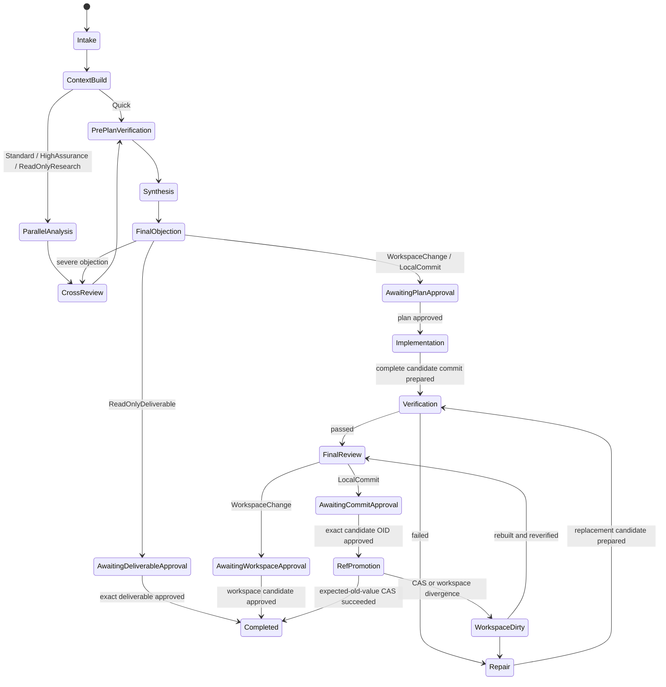

# Workflow Orchestration v4.2

> **v4.3 authority notice:** workflow rules and persistence are superseded by `schemas/workflow-transitions.v3.json`, `schemas/sqlite-v7.sql`, and `16-workflow-transition-specification.md`. The remaining orchestration rationale is retained where it does not conflict.


## 1. Model

The workflow combines deterministic phases with bounded agent discretion. The state machine owns safety and lifecycle. Lead agents may recommend participants, evidence requests, and additional debate inside allowed phases.

## 2. Trusted workflow selection and state machine

The trusted core selects both `WorkflowProfile` and `TaskOutcomeMode` from risk,
scope, policy, and an optional explicit user override. An agent may recommend a
profile but may never select or persist one.

Profiles:

| Profile | Intended scope | Mandatory orchestration |
|---|---|---|
| `Quick` | low-risk deterministic work | one primary agent, deterministic checks, targeted review when policy requires |
| `Standard` | normal feature or defect work | independent analysis and targeted cross-review |
| `HighAssurance` | auth, migration, data-loss, release, critical policy | full independent quorum, objection round, verification, exact approvals |
| `ReadOnlyResearch` | architecture, research, onboarding, assessment | evidence verification and deliverable approval; no write or Git phases |

Outcome modes are independent of profile:

- `ReadOnlyDeliverable` finishes through exact deliverable approval;
- `WorkspaceChange` finishes with an approved, verified workspace candidate but no ref update;
- `LocalCommit` finishes only after expected-old-value ref CAS to one pre-created verified commit OID.



`Paused`, `Blocked`, and `BudgetExhausted` remain resumable conditions.
`Completed`, `Cancelled`, and `Failed` are terminal phases. The normative machine
projection is [`schemas/workflow-transitions.v2.json`](schemas/workflow-transitions.v2.json).
The previous v1 projection is retained only as migration and regression input.

## 3. Phase contracts

### 3.1 Intake

Inputs:

- repository;
- task objective;
- scope;
- policies;
- budgets;
- user agent selections.

Outputs:

- validated task record;
- risk classification;
- worktree plan;
- required approvals.

### 3.2 ContextBuild

Outputs:

- repository map;
- initial project-memory retrieval;
- agent-specific context packages;
- sensitivity classification.

### 3.3 ParallelAnalysis

Rules:

- proposals are hidden from other analyzers until submission;
- the profile-specific quorum applies: `Quick` may use one primary agent; `Standard`, `HighAssurance`, and `ReadOnlyResearch` require the configured independent evidence path;
- no file writes;
- read-only tools may run under policy.

Completion:

- quorum reached;
- time or cost budget reached with minimum evidence;
- user stops the phase.

Early consensus may skip only work that the selected profile marks optional. It never skips required mechanical verification or the outcome-specific acceptance gate.

### 3.4 CrossReview

The orchestrator assigns review edges rather than broadcasting every proposal to every agent. This limits cost and repetitive feedback.

Example assignment:

```text
Architecture proposal → security critic + implementation critic
Security proposal → repository specialist
Implementation proposal → architecture critic
```

### 3.5 PrePlanVerification

Verifier agents and deterministic tools validate material claims before synthesis. Unsupported claims are marked rejected or inconclusive.

### 3.6 Synthesis

The lead creates a decision package with:

- selected approach;
- rejected alternatives and reasons;
- verified evidence;
- remaining dissent;
- implementation steps;
- affected files;
- test and rollback plan;
- risk score;
- confidence.

### 3.7 FinalObjection

Participants receive the draft decision package and may file one structured final objection. Objections require severity, impact, and evidence.

Reopen criteria:

- credible security or data-loss risk;
- contradiction with verified repository evidence;
- material unaddressed requirement;
- implementation infeasibility;
- policy violation.

### 3.8 AwaitingPlanApproval

User actions:

- approve;
- request revision;
- continue debate;
- replace or add agent;
- reject;
- change scope or policy.

### 3.9 Implementation

- one durable executor lease with a monotonically increasing fencing token;
- changes follow an approved step plan;
- each file mutation is captured;
- commands execute through tools;
- plan deviations require explicit event and may require approval.

Every write tool validates the lease and token immediately before the side
effect. A new lease invalidates all older in-flight requests. Delegation means
releasing and reacquiring the lease; it never means simultaneous writers.
Submitting implementation revokes the lease, reconciles the workspace, and prepares both the immutable candidate Git tree and the complete immutable candidate commit object. Commit parents, author/committer identities, timestamps, message, headers, and signatures are fixed before verification.

### 3.10 Verification

Verification suites run in configured order against a clean disposable worktree materialized from the candidate tree. Every passing result binds both `candidate_tree_oid` and `candidate_commit_oid`; verification produces an immutable final-commit verification receipt. Failures include evidence and classification.

### 3.11 Repair

The failed candidate tree, complete commit object reference, verification receipt, and dependent approvals are invalidated together. A newly fenced executor receives bounded failure context. Submitting repair creates a new complete candidate commit before verification.

### 3.12 FinalReview

A reviewer compares the immutable candidate tree and commit OID with the approved plan and verification receipt. Entering final review revokes the executor lease. A successful review cites both exact OIDs. Any workspace mutation invalidates the complete candidate tuple and enters `WorkspaceDirty`.

### 3.13 AwaitingDeliverableApproval

For `ReadOnlyDeliverable`, the user approves an exact immutable package containing
the report artifact, evidence set, unresolved objections, evaluator receipt, and
credential-bound acceptance receipt. This path reaches `Completed` without
entering implementation, verification, or Git finalization phases.

### 3.14 AwaitingWorkspaceApproval

For `WorkspaceChange`, the user approves the verified candidate tree/commit tuple
as a workspace deliverable. No repository ref is updated. Repair invalidates the
candidate tuple and acceptance request.

### 3.15 AwaitingCommitApproval

For `LocalCommit`, the user inspects and approves the exact pre-created candidate
commit OID, candidate tree OID, expected ref, expected old OID, verification set,
commit metadata, actor/session binding, and hook policy.

### 3.16 RefPromotion

`RefPromotion` never constructs a commit. The broker performs only an
expected-old-value compare-and-swap attaching the approved ref to the approved
candidate commit OID. Success requires the ref to equal that OID; divergence is
recorded honestly and moves the task to `WorkspaceDirty`.

### 3.17 WorkspaceDirty

This phase indicates an out-of-band write, unexpected generated file, stale
fencing token attempt, or mutation after approval. The system:

1. revokes the current executor lease;
2. invalidates open plan, tool, and commit approvals affected by the mutation;
3. records pre/post workspace evidence;
4. blocks new writes;
5. offers reconcile, authorized repair, preserve, or discard.

## 4. Role model

Default roles:

- `analyst`: independent understanding and proposal;
- `architect`: system-level trade-offs;
- `critic`: challenge assumptions and identify omissions;
- `repository-specialist`: ground proposals in existing code;
- `security-reviewer`: threats and policy risk;
- `verifier`: mechanically validate claims and outputs;
- `lead`: synthesize decisions;
- `executor`: own writes;
- `final-reviewer`: inspect diff and test adequacy.

A single agent may hold multiple roles in small workflows, but the executor and final reviewer should be different agents when possible.

Agent role separation is an orchestration preference, not a security boundary.
Only core identity binding, policy, sandboxing, leases, and tool mediation grant
capabilities.

## 5. Agent selection score

The orchestrator computes eligibility first, then ranking:

```text
score = capability_fit
      + repository_fit
      + historical_reliability
      + locality_preference
      + availability
      - expected_cost
      - expected_latency
      - policy_risk
```

The user may override ranking or lock assignments.

## 6. Stop conditions

A phase ends when any condition applies:

- required outputs are complete;
- no unresolved high-severity objections remain;
- new critique value falls below a configured threshold;
- maximum rounds reached;
- token, cost, or time budget exhausted;
- user stops or cancels;
- policy blocks further work;
- insufficient eligible agents remain.

A model cannot unilaterally declare the whole task complete. It may recommend completion.

User cancellation is accepted from every nonterminal phase. If a non-idempotent
operation is in flight, cancellation first stops new work and then resolves the
operation as completed, failed, terminated, or indeterminate before the task
becomes terminal.

## 7. Budgets

Per-task budgets:

- maximum agents;
- maximum concurrent runs;
- maximum analysis rounds;
- maximum repair rounds;
- maximum wall-clock duration;
- maximum provider cost;
- maximum context tokens per run;
- maximum tool execution duration.

The dispatcher reserves estimated cost and tokens before parallel runs start so
concurrent requests cannot each spend the same remaining budget. Exhaustion
sets the `BudgetExhausted` condition. The user may extend the budget and resume
the preserved phase; otherwise the task may be cancelled or preserved as
blocked.

## 8. Recovery

On startup:

1. Load task stream and rebuild state.
2. Detect runs marked started without terminal result.
3. Inspect child-process and tool-operation records.
4. Mark unrecoverable processes interrupted.
5. Revoke stale executor leases and allocate a newer fencing epoch.
6. Reconcile artifact intents, worktree status, Git tree identity, and file hashes.
7. Invalidate approvals whose canonical inputs no longer match.
8. Offer resume, retry, inspect, preserve, or cancel based on phase.

No command is automatically repeated unless it was declared idempotent and no completion evidence exists.

## 9. v3 machine transition and fencing rules

Every command carries an expected task `row_version`. A successful authoritative transition increments it exactly once. Raw mutation outside the storage transition API is not a supported production path.

Lease transfer is not an in-place holder edit. The grant transaction increments `tasks.fencing_epoch` exactly once and appends a new immutable lease-history row. The previous active lease is terminalized. Holder identity and fencing token on a lease row never change.

External mutation uses a per-task barrier shared by lease grant/transfer and broker promotion. Heavy preparation occurs outside the barrier in private staging. Inside it the broker revalidates the exact active tuple and performs only the resource commit point plus conditional evidence persistence. The allowed race outcomes are:

- the old effect commits before the newer grant; or
- the newer grant commits first and the old effect produces zero authoritative mutation.

No third ordering is acceptable.

## 10. v4 cognitive lifecycle integration

The top-level task state machine remains stable. Cognitive behavior is added as mandatory or optional substeps so v3.2 recovery and approval semantics remain compatible.

### 10.1 Intake

- classify objective and task class;
- establish success criteria and initial unknowns;
- resolve allowed preference scope;
- create the benchmark/configuration identity when the task is part of an evaluation run.

### 10.2 ContextBuild

1. create typed retrieval plan;
2. execute permitted retrieval branches;
3. re-read and validate authoritative sources;
4. search applicable negative memory and contradictions;
5. compile immutable role-specific packages;
6. record coverage gaps and degraded branches;
7. block progression when mandatory evidence classes are absent.

### 10.3 Agent execution phases

During ParallelAnalysis, CrossReview, Synthesis, Implementation, Verification, and FinalReview:

- working-memory updates are sequenced and checkpointed;
- agents distinguish facts, inferences, and unknowns;
- progressive supplements follow parent-run budgets and permissions;
- context feedback is captured without mutating active rank state;
- a write-capable action must consider applicable negative memory and unresolved high-severity contradictions.

### 10.4 Outcome evaluation

After each material terminal run:

1. collect deterministic tool and workflow receipts;
2. verify claims and success criteria;
3. create immutable role-specific evaluation;
4. decide pass, repair, blocked, or indeterminate;
5. only then open the learning-extraction step.

### 10.5 Learning extraction

Learning extraction is best-effort and never changes the already determined task outcome. It produces candidate memory proposals. Promotion is a separate authority operation and may require user approval.

### 10.6 Repeated-error guard

Before approving a plan or dispatching a write-capable step, the orchestrator checks whether an applicable active negative memory or prior verified reviewer finding would be violated. A conflict requires explicit resolution, supersession evidence, or user-approved exception.
