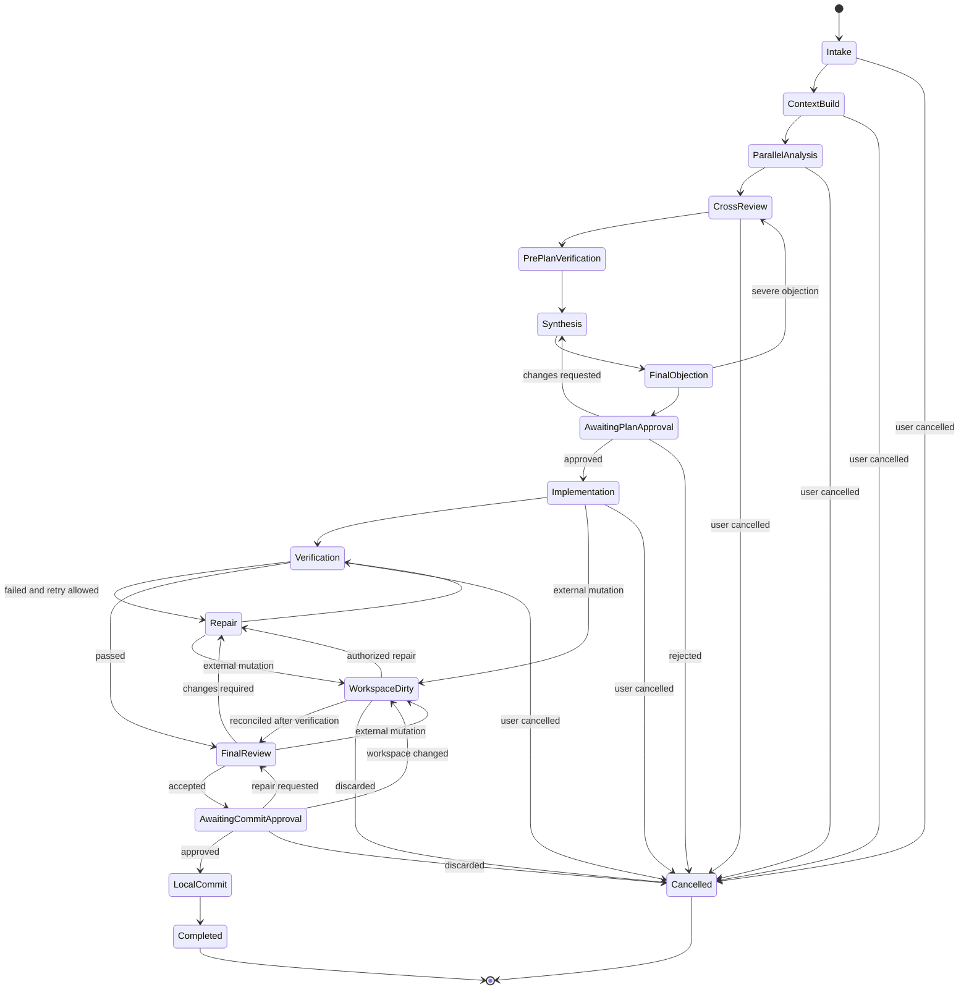

# Workflow Orchestration

## 1. Model

The workflow combines deterministic phases with bounded agent discretion. The state machine owns safety and lifecycle. Lead agents may recommend participants, evidence requests, and additional debate inside allowed phases.

## 2. State machine



`Paused`, `Blocked`, and `BudgetExhausted` are workflow conditions, not terminal
phases. They preserve the current phase and may resume through explicit user or
system events. `Failed`, `Completed`, and `Cancelled` are terminal.

Tool and policy approvals are operation substates attached to the current
phase; they do not silently advance the workflow. The normative guard and
transition table is
[Workflow transition specification](16-workflow-transition-specification.md)
and its machine-readable projection is
[`schemas/workflow-transitions.v1.json`](schemas/workflow-transitions.v1.json).

## 3. Phase contracts

### 3.1 Intake

Inputs:

- repository;
- task objective;
- scope;
- policies;
- budgets;
- user agent selections.

Outputs:

- validated task record;
- risk classification;
- worktree plan;
- required approvals.

### 3.2 ContextBuild

Outputs:

- repository map;
- initial project-memory retrieval;
- agent-specific context packages;
- sensitivity classification.

### 3.3 ParallelAnalysis

Rules:

- proposals are hidden from other analyzers until submission;
- at least two independent analyses when two eligible agents exist;
- no file writes;
- read-only tools may run under policy.

Completion:

- quorum reached;
- time or cost budget reached with minimum evidence;
- user stops the phase.

Early consensus may skip additional review rounds, but never the first
independent analysis quorum, required mechanical verification, plan approval,
or final approval.

### 3.4 CrossReview

The orchestrator assigns review edges rather than broadcasting every proposal to every agent. This limits cost and repetitive feedback.

Example assignment:

```text
Architecture proposal → security critic + implementation critic
Security proposal → repository specialist
Implementation proposal → architecture critic
```

### 3.5 PrePlanVerification

Verifier agents and deterministic tools validate material claims before synthesis. Unsupported claims are marked rejected or inconclusive.

### 3.6 Synthesis

The lead creates a decision package with:

- selected approach;
- rejected alternatives and reasons;
- verified evidence;
- remaining dissent;
- implementation steps;
- affected files;
- test and rollback plan;
- risk score;
- confidence.

### 3.7 FinalObjection

Participants receive the draft decision package and may file one structured final objection. Objections require severity, impact, and evidence.

Reopen criteria:

- credible security or data-loss risk;
- contradiction with verified repository evidence;
- material unaddressed requirement;
- implementation infeasibility;
- policy violation.

### 3.8 AwaitingPlanApproval

User actions:

- approve;
- request revision;
- continue debate;
- replace or add agent;
- reject;
- change scope or policy.

### 3.9 Implementation

- one durable executor lease with a monotonically increasing fencing token;
- changes follow an approved step plan;
- each file mutation is captured;
- commands execute through tools;
- plan deviations require explicit event and may require approval.

Every write tool validates the lease and token immediately before the side
effect. A new lease invalidates all older in-flight requests. Delegation means
releasing and reacquiring the lease; it never means simultaneous writers.
Submitting implementation revokes the lease, reconciles the workspace, and
creates the immutable candidate Git tree used by verification.

### 3.10 Verification

Verification suites run in configured order against a clean disposable
worktree materialized from the candidate Git tree. Every result cites that tree.
Failures include evidence and classification.

### 3.11 Repair

The failed candidate is discarded. A newly fenced executor receives bounded
failure context. It may modify only files related to the failure or request
scope expansion. Submitting repair creates a new candidate before verification.

### 3.12 FinalReview

A reviewer compares the immutable candidate Git tree with the approved plan and
verification results. Entering final review revokes the executor lease. If the
worktree changes, the candidate is invalid and the task enters
`WorkspaceDirty`.

### 3.13 AwaitingCommitApproval

The user inspects the decision package, exact candidate tree, final diff,
checks, risks, commit message, hook policy, and canonical approval digest.

### 3.14 LocalCommit

The system creates a local commit from the approved Git tree only after final
approval. It does not rebuild the tree from mutable working files. Commit
metadata includes the task ID, while sensitive deliberation is not placed in
the commit message. The resulting commit tree must equal the approved tree ID.

### 3.15 WorkspaceDirty

This phase indicates an out-of-band write, unexpected generated file, stale
fencing token attempt, or mutation after approval. The system:

1. revokes the current executor lease;
2. invalidates open plan, tool, and commit approvals affected by the mutation;
3. records pre/post workspace evidence;
4. blocks new writes;
5. offers reconcile, authorized repair, preserve, or discard.

## 4. Role model

Default roles:

- `analyst`: independent understanding and proposal;
- `architect`: system-level trade-offs;
- `critic`: challenge assumptions and identify omissions;
- `repository-specialist`: ground proposals in existing code;
- `security-reviewer`: threats and policy risk;
- `verifier`: mechanically validate claims and outputs;
- `lead`: synthesize decisions;
- `executor`: own writes;
- `final-reviewer`: inspect diff and test adequacy.

A single agent may hold multiple roles in small workflows, but the executor and final reviewer should be different agents when possible.

Agent role separation is an orchestration preference, not a security boundary.
Only core identity binding, policy, sandboxing, leases, and tool mediation grant
capabilities.

## 5. Agent selection score

The orchestrator computes eligibility first, then ranking:

```text
score = capability_fit
      + repository_fit
      + historical_reliability
      + locality_preference
      + availability
      - expected_cost
      - expected_latency
      - policy_risk
```

The user may override ranking or lock assignments.

## 6. Stop conditions

A phase ends when any condition applies:

- required outputs are complete;
- no unresolved high-severity objections remain;
- new critique value falls below a configured threshold;
- maximum rounds reached;
- token, cost, or time budget exhausted;
- user stops or cancels;
- policy blocks further work;
- insufficient eligible agents remain.

A model cannot unilaterally declare the whole task complete. It may recommend completion.

User cancellation is accepted from every nonterminal phase. If a non-idempotent
operation is in flight, cancellation first stops new work and then resolves the
operation as completed, failed, terminated, or indeterminate before the task
becomes terminal.

## 7. Budgets

Per-task budgets:

- maximum agents;
- maximum concurrent runs;
- maximum analysis rounds;
- maximum repair rounds;
- maximum wall-clock duration;
- maximum provider cost;
- maximum context tokens per run;
- maximum tool execution duration.

The dispatcher reserves estimated cost and tokens before parallel runs start so
concurrent requests cannot each spend the same remaining budget. Exhaustion
sets the `BudgetExhausted` condition. The user may extend the budget and resume
the preserved phase; otherwise the task may be cancelled or preserved as
blocked.

## 8. Recovery

On startup:

1. Load task stream and rebuild state.
2. Detect runs marked started without terminal result.
3. Inspect child-process and tool-operation records.
4. Mark unrecoverable processes interrupted.
5. Revoke stale executor leases and allocate a newer fencing epoch.
6. Reconcile artifact intents, worktree status, Git tree identity, and file hashes.
7. Invalidate approvals whose canonical inputs no longer match.
8. Offer resume, retry, inspect, preserve, or cancel based on phase.

No command is automatically repeated unless it was declared idempotent and no completion evidence exists.
