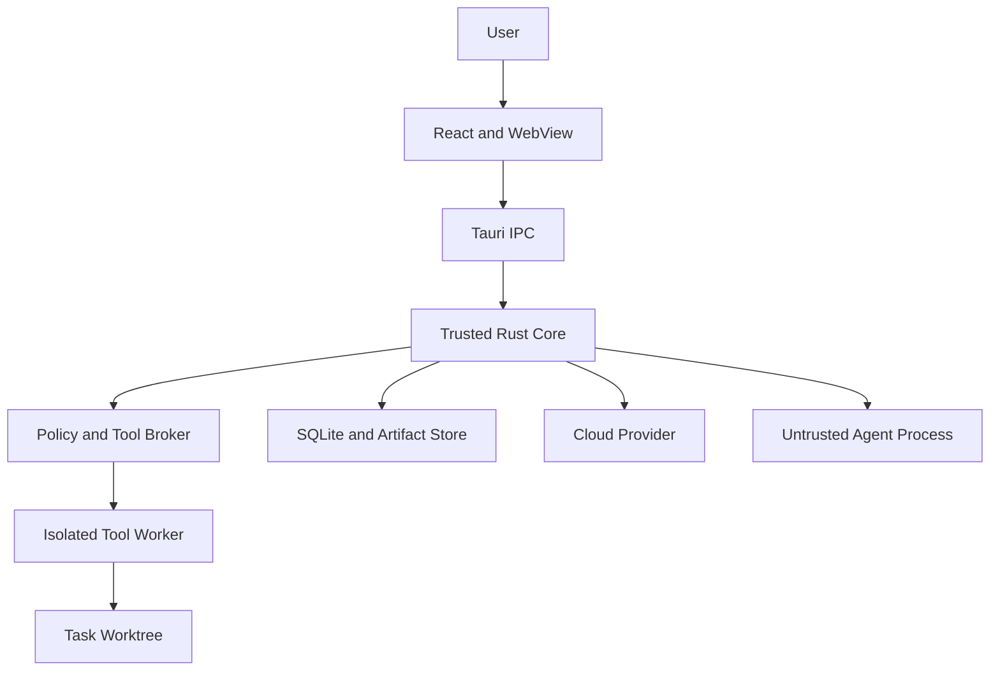

# Security Architecture and Threat Model

## 1. Overview

The product is a Windows-first local desktop runtime that sends selected
repository context to local or cloud AI agents and can execute approved tools
inside a Git worktree. The highest-impact failures are unauthorized disclosure,
arbitrary execution under the user's identity, modification of the wrong
workspace, approval of different bytes than the user reviewed, and audit or
recovery state that falsely claims safety.

The trusted computing base for MVP is:

- the signed Rust core and built-in adapters;
- the versioned policy bundle;
- the bootstrap/composition root;
- the SQLite and artifact-store implementations;
- the native approval binding code;
- the selected Windows isolation implementation.

React/WebView presentation, repository content, model output, external agent
processes, cloud providers, build scripts, terminal output, and plugins are
untrusted inputs.

## 2. Assets and security objectives

### Assets

- repository source, history, untracked files, and proprietary metadata;
- provider credentials and other user secrets;
- task worktrees and candidate Git trees;
- approval records and executor leases;
- event, artifact, context, and verification history;
- user identity, filesystem, network access, registry, and local credentials;
- provider budget and rate limits;
- update and plugin trust configuration.

### Objectives

1. No unapproved disclosure crosses a local-to-cloud boundary.
2. No untrusted process gains ambient access to the repository or user profile.
3. Only the current fenced executor can request a write.
4. Approval authorizes exactly the bytes and operation displayed.
5. A crash cannot convert an unknown operation into a false success or an
   automatic unsafe retry.
6. Audit records distinguish verified core observations from model claims.
7. Policy failure is fail-closed.
8. The final commit tree equals the reviewed and approved tree.

## 3. Threat model, trust boundaries, and assumptions

### 3.1 Actors and controlled inputs

| Actor | Control level | Representative inputs |
|---|---|---|
| User/operator | Trusted intent, fallible interaction | task, policy override, approval, terminal use |
| Repository author | Potential attacker | source, docs, config, filenames, Git attributes, hooks, build scripts |
| Local agent process | Untrusted | protocol frames, tool/context requests, terminal output |
| Cloud provider | External untrusted processor | responses, usage reports, tool claims, streamed text |
| Plugin publisher | Untrusted until installed and isolated | executable, manifest, updates |
| Dependency publisher | Potential supply-chain attacker | packages, installers, build-time code |
| Local malware/admin | Outside primary containment guarantee | database/file replacement, process injection, memory access |

Operator-controlled input is not automatically safe. A pasted command, imported
manifest, or policy exception may originate from an attacker.

### 3.2 Trust boundaries



Boundary rules:

- WebView input never calls filesystem, process, Git, secret, or approval
  primitives directly.
- Tauri commands validate DTO size, type, task scope, actor session, and
  operation digest.
- agent processes receive context by value or opaque broker references, not OS
  paths;
- only the tool worker receives scoped worktree access;
- cloud egress passes classification, redaction, final serialized-payload scan,
  and policy evaluation;
- artifact bytes are verified before use as evidence.

### 3.3 Assumptions

- the signed Rust core and operating system are not already compromised;
- the user can knowingly approve a clearly displayed dangerous action;
- Git and selected toolchain binaries are trusted only at recorded paths and
  versions;
- the repository itself is hostile;
- provider-side retention and training behavior is a policy attribute, not an
  implicit trust assumption;
- local administrator or kernel compromise is out of scope for containment.

Out of scope does not mean undetectable. Hashes and signed checkpoints may
detect later modification, but hashes stored beside data do not resist an
attacker who can rewrite the entire local store.

## 4. Enforced trust tiers

| Tier | Meaning | MVP |
|---|---|---|
| `core_adapter` | Reviewed adapter code linked into or shipped with the signed core | Allowed |
| `brokered_process` | External process with protocol I/O only and no ambient repository access | Allowed after containment tests |
| `isolated_worker` | External process in an OS/VM boundary with explicitly mounted resources | Optional |
| `full_access_legacy` | CLI receives user-level repository/shell access | Disabled |

ConPTY is terminal I/O. Job Objects provide lifecycle, process-tree termination,
and resource limits. Neither is claimed as filesystem, registry, credential, or
network isolation. The normative controls are in
[Trust and sandbox model](13-trust-sandbox-model.md).

## 5. Attack surface, mitigations, and attacker stories

### T-001 Repository prompt injection

An attacker places instructions in source, tests, issue text, filenames, or tool
output that ask an agent to disclose secrets or bypass policy.

Controls:

- retrieved content is labeled untrusted data;
- system/role instructions are transported separately;
- policy and tool authorization execute outside the model;
- denied resources remain denied regardless of model reasoning;
- evidence and instruction channels are distinct in context schemas;
- generated tool requests are validated as hostile input.

### T-002 Secret or proprietary-data exfiltration

Disclosure may occur through direct reads, vector/graph indexes, summaries,
tool output, error messages, filenames, environment variables, or cloud
embedding APIs.

Controls:

- classification and secret scanning before every index;
- local embedding by default;
- per-item disclosure decisions and final serialized-payload scan;
- provider endpoint allowlist;
- no inherited environment secrets;
- exact outbound digest, policy snapshot, redaction report, and provider binding;
- policy exceptions are digest-bound, expiring, and human-approved.

### T-003 Untrusted process escape

An agent or plugin bypasses tool mediation using direct OS APIs.

Controls:

- no repository path or inherited user shell for `brokered_process`;
- dedicated low-privilege identity or stronger sandbox when OS access is needed;
- explicit filesystem ACL and network policy;
- no user-profile, credential-store, registry, or named-pipe access;
- Job Object kill-on-close without breakaway for process cleanup;
- canary tests for denied files, network, registry, and child-process escape.

If these controls cannot be enforced, the integration is classified
`full_access_legacy` and disabled in MVP.

### T-004 Tool and shell injection

A model supplies metacharacters, path traversal, shell expansion, executable
substitution, malicious response files, or an attacker-controlled binary.

Controls:

- structured tools use canonical executable references and argument arrays;
- no shell parser is used to classify a free-form command as safe;
- cwd, environment profile, network mode, timeout, expected writes, and
  executable digest are policy inputs;
- `shell.raw` is a distinct high-risk tool;
- canonicalize and revalidate paths at the last responsible moment;
- reject symlink, junction, device-path, UNC, alternate-data-stream, and
  case-normalization escapes where not explicitly supported.

### T-005 Worktree escape and stale writer

A write traverses outside the root, a former executor continues after lease
loss, or a user terminal changes files after review.

Controls:

- durable lease with monotonic fencing token;
- token check immediately before each write;
- broker opens files relative to a validated directory handle where supported;
- worktree monitor detects out-of-band changes;
- unexpected mutation enters `WorkspaceDirty` and invalidates approvals;
- final commit uses the approved Git tree, not mutable worktree contents.

### T-006 Approval spoofing or time-of-check/time-of-use

The UI displays benign input while the core executes different input, or files
change after approval.

Controls:

- core creates canonical digest using RFC 8785 JCS and SHA-256;
- approval includes task, actor, policy version, expiry, base commit, tree ID,
  command, environment, and hook policy as applicable;
- UI receives immutable approval DTOs and cannot select a different operation;
- a mutation or policy change revokes affected approvals;
- native confirmation is required for destructive and final-commit actions;
- execution re-computes and compares the digest immediately before effect.

### T-007 Event, artifact, or projection tampering

Controls:

- append-only event API with optimistic concurrency;
- content-addressed artifacts and verified sizes;
- startup integrity and reference checks;
- projections are rebuildable;
- optional hash-chain checkpoints signed by an OS-protected local key;
- export manifests include hashes and signatures.

Local hashes primarily detect corruption. Resistance to a local administrator
requires a protected signing key or external trust anchor and is not implied by
append-only SQLite semantics.

### T-008 WebView, IPC, and terminal-output attacks

Untrusted Markdown, ANSI escape sequences, links, or compromised frontend code
may spoof state or request privileged IPC calls.

Controls:

- no remote content in the privileged WebView;
- restrictive Content Security Policy and no arbitrary script evaluation;
- narrow Tauri command allowlist with schema and size validation;
- privilege enforcement in Rust, never React;
- terminal OSC clipboard operations disabled by default;
- hyperlinks require confirmation and scheme allowlisting;
- untrusted terminal title, notification, and file-transfer escape sequences
  are ignored;
- critical approval shows core-generated operation summary and digest.

### T-009 Build scripts, Git hooks, and dependency execution

Controls:

- package installation, build scripts, hooks, and networked builds are separate
  risk classifications;
- final commit hook policy is part of the approval digest;
- default final commit uses an exact prepared tree with hooks disabled;
- enabling hooks requires explicit approval and any tree mutation restarts
  final review;
- toolchain paths and versions are recorded;
- output, exit status, duration, environment profile, and file changes are
  captured.

### T-010 Plugin and update supply chain

Controls:

- MVP permits built-in adapters and explicitly registered local manifests only;
- unsigned third-party executable plugins remain disabled until sandbox
  acceptance tests pass;
- application and update packages are signed;
- update metadata is authenticated and resists version rollback;
- plugin executable digest and permission changes require reapproval;
- no update is applied during an indeterminate external operation.

### T-011 Cost and resource exhaustion

Controls:

- reserve budget before parallel dispatch;
- bound agent count, request count, stream bytes, context bytes, runtime, memory,
  disk use, and repair rounds;
- rate-limit duplicate requests;
- cancellation propagates to process trees and provider calls;
- disk reserve prevents a full-volume crash during artifact or SQLite writes.

### T-012 Recovery confusion and unsafe retry

An operation completes externally but the app crashes before recording success.

Controls:

- persist intent before side effect;
- classify every operation as idempotent, queryable, or non-repeatable;
- reconcile using authoritative evidence;
- never repeat an indeterminate non-idempotent operation automatically;
- use fencing tokens and expected Git ref values;
- show `indeterminate` honestly when proof is unavailable.

## 6. Policy model

Policy requests include the effective actor binding and complete operation:

```json
{
  "actor": {
    "connectionId": "conn-71",
    "agentId": "cloud-critic",
    "trustTier": "core_adapter",
    "locality": "cloud"
  },
  "action": "context.disclose",
  "resource": {
    "sourceId": "src/auth/token.ts",
    "contentDigest": "sha256:..."
  },
  "resourceClass": "internal-code",
  "taskRisk": "medium",
  "workflowPhase": "CrossReview",
  "purpose": "Review authentication proposal",
  "policySnapshotDigest": "sha256:..."
}
```

Decision:

```json
{
  "effect": "allow_with_redaction",
  "rules": ["cloud-selected-code", "secret-pattern-redaction"],
  "expiresAt": "2026-07-23T14:00:00Z",
  "operationDigest": "sha256:..."
}
```

Effects:

- `allow`
- `deny`
- `require_approval`
- `allow_with_redaction`

Policy evaluation uses deny-overrides semantics. Decisions are not reusable when
the actor binding, resource digest, purpose, phase, policy snapshot, or expiry
changes.

## 7. Secrets and sensitive artifacts

Provider keys use DPAPI or Windows Credential Manager with explicit user scope.
Plaintext keys never enter project directories, events, diagnostic logs,
indexes, command environments, or prompts.

If an approved operation legitimately handles secret material:

- ordinary diagnostic logging stores only a stable redacted identifier;
- exact secret-bearing artifacts use a restricted encrypted store or are not
  retained;
- exports omit them unless the user selects a separately encrypted export;
- deletion uses key destruction where physical secure erase cannot be
  guaranteed.

Application-data directories receive restrictive ACLs. An opt-in project-local
artifact root is excluded from Git automatically and cannot be located inside a
task worktree.

## 8. Audit semantics

Audit records distinguish:

- `core_observed`;
- `tool_verified`;
- `provider_reported`;
- `agent_claimed`;
- `user_asserted`.

Each record includes actor binding, effective role, requested operation,
policy/approval IDs, exact scope, canonical digest, authoritative receipt time,
result, and correlation/causation IDs. A model-provided timestamp or cost is
never silently presented as a core observation.

## 9. Severity calibration

### Critical

- unauthenticated or unapproved remote code execution through an agent,
  update, IPC, or plugin path;
- silent cloud disclosure of denied repository secrets at material scale;
- final commit of a different tree than the one explicitly approved;
- policy bypass granting unrestricted user-profile access to an untrusted
  process.

### High

- write outside the task worktree;
- stale executor retaining write capability;
- approval replay for a changed command or tree;
- unsigned update accepted as trusted;
- event/artifact tampering that produces a false verified or committed state.

### Medium

- cost-limit bypass with bounded financial impact;
- terminal escape that changes clipboard or spoofs noncritical presentation;
- stale evidence accepted without changing code or disclosure;
- denial of service requiring task recovery but not causing data loss.

### Low

- inaccurate nonauthoritative health or token estimate;
- cosmetic workflow-state mismatch that cannot grant capability;
- sanitized diagnostic metadata exposure without repository or user secrets.

Severity assumes the signed core and OS are not already compromised. Findings
requiring local administrator or kernel control are normally out of scope unless
they cross a documented protection boundary such as the OS-protected signing
key.

## 10. Security acceptance criteria

- denied content cannot be obtained through direct read, keyword/vector/graph
  retrieval, context query, summary, filename metadata, tool output, or shell;
- an untrusted process fails canary reads outside its root, denied network
  connections, registry/credential access, and child-process escape tests;
- changing any canonical operation field invalidates approval;
- a stale fencing token can never write;
- a cancelled Job Object leaves no breakaway child;
- path traversal, junction, symlink, UNC, device path, alternate data stream,
  and case-folding tests fail closed;
- final commit tree equals the approved Git tree ID;
- WebView compromise cannot directly invoke an unauthorized Rust capability;
- terminal output cannot set clipboard or silently launch a URL;
- tampered artifacts are rejected before use as evidence;
- crash injection never automatically repeats an indeterminate non-idempotent
  operation;
- no agent can transition workflow state, change trust tier, or grant itself a
  permission.

## 11. v3 proof-bearing security claims

Security claims are capability-specific. A Boolean such as `containment_verified` is not evidence. External enablement requires an immutable exact-tuple attestation covering executable digest, manifest digest, launcher digest, isolation profile digest, Windows build, architecture, suite version, and evidence artifact. Any tuple change or revocation disables execution fail-closed.

Containment and fencing form one control. A worker with a direct writable authoritative handle is outside the supported model because a database lease revocation cannot revoke an already-open handle. Private per-attempt staging plus broker-only promotion is mandatory for the write-capable profile.

The hostile installed-product suite must test repository/profile/app-data/credential/registry access, reparse/UNC/device/ADS escape, loopback/LAN/internet, named-pipe and privileged IPC access, detached/breakaway descendants, resource exhaustion, and stale-token writes. Denied-access success, surviving descendants, and stale authoritative mutations must each equal zero.

## v4 cognitive-memory threats and controls

### Memory poisoning

**Threat:** untrusted repository text, model output, retrieved web content, or agent reflection becomes durable guidance.

**Controls:** candidate-only ingestion, authoritative evidence links, lifecycle gates, conflict detection, quarantine, scoped approval, append-only versions, and no activation by model agreement.

### Cross-project memory leakage

**Threat:** retrieval or relation edges expose another project's code, preference, episode, or memory.

**Controls:** project-scoped authority keys, database triggers, adapter conformance tests, opaque references, policy pre-filtering, and final serialized-payload canaries.

### Stale or superseded memory

**Threat:** an agent follows a previously correct rule after its source or applicability conditions changed.

**Controls:** source hashes, applicability predicates, index generation, stale lifecycle state, mandatory freshness check before package inclusion, and revalidation after repository revision changes.

### Retrieval manipulation

**Threat:** attacker-controlled content repeats keywords or embedding bait to dominate context.

**Controls:** source trust labels, diversity limits, deterministic rank fusion, bounded contribution per source, evidence-strength scoring, contradiction retrieval, and inspection of why each item was selected.

### Reflection self-approval

**Threat:** an agent claims success and promotes its own lesson.

**Controls:** separate verifier, evaluator, learning, and memory-authority components; deterministic receipts; immutable evaluation; and explicit promotion policy.

### Sensitive embedding and reranking disclosure

**Threat:** denied content reaches a remote embedding or reranking provider.

**Controls:** classification before indexing, local default, external-disclosure policy, exact outbound receipt, provider allowlist, and route-complete canary tests.
