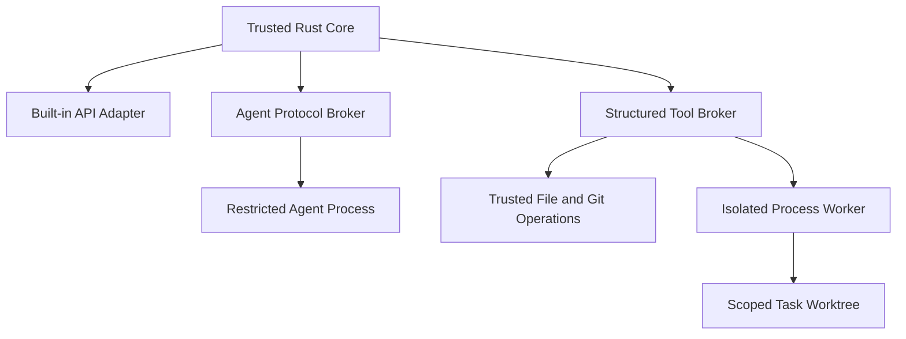

# Trust and Sandbox Model

## 1. Purpose

This document defines which components are trusted, which operating-system
controls enforce access, and which integrations are intentionally disabled.
The central rule is:

> A protocol, working directory, prompt instruction, Job Object, or ConPTY
> session does not prevent a process from using direct operating-system APIs.

Security claims are based on enforced identities, ACLs, network rules,
capability brokers, and—when required—a container or VM boundary.

## 2. Trusted computing base

MVP trusts:

- the signed Rust core;
- built-in `core_adapter` implementations;
- policy evaluation and approval binding;
- filesystem/Git brokers that do not execute repository-controlled code;
- the bootstrap composition root;
- storage and reconciliation code;
- the selected Windows isolation launcher.

The following remain untrusted:

- repository bytes, Git metadata, attributes, hooks, and build scripts;
- model and provider output;
- external agents and their manifests;
- tool subprocesses that execute repository-controlled code;
- terminal output and rendered Markdown;
- third-party plugins and updates until verified.

## 3. Trust tiers

### 3.1 `core_adapter`

A reviewed adapter ships inside the signed application and converts between the
application protocol and a provider API. It has no authority beyond the Rust
ports injected into it.

Use for the first two heterogeneous cloud/API integrations.

### 3.2 `brokered_process`

An external protocol process runs under a dedicated low-privilege identity or
equivalent enforced boundary. It receives:

- a private runtime directory;
- stdin/stdout protocol pipes;
- bounded stderr;
- no repository or user-profile ACL;
- no inherited secrets;
- only explicitly permitted network endpoints;
- a Job Object that kills the complete process tree.

The process receives context bytes or opaque references. It never receives an
OS path to an authorized file.

If the platform cannot create and verify this boundary, the process cannot be
classified `brokered_process`.

### 3.3 `isolated_worker`

An external process runs in an approved container or VM boundary. Only declared
read-only toolchains, caches, and a scoped task volume are exposed. Network is
deny-by-default.

Use for repository-controlled builds or sophisticated local agents that cannot
operate purely through the protocol broker.

### 3.4 `full_access_legacy`

A CLI runs under the user's normal token with repository paths and its own
shell/tools. This mode can bypass every broker rule.

It is disabled in MVP. If later offered for compatibility, the UI must state
that the application cannot enforce repository, secret, network, or write
isolation. It must not reuse the word “sandboxed”.

### 3.5 Retrieval sidecar classification

The embedded retrieval adapter ships as a reviewed `core_adapter`. The optional
external retrieval sidecar **MUST run as `brokered_process`** by default. It is
not part of the trusted core merely because it implements `RetrievalEngine`.

The sidecar receives canonical request bytes or opaque source references over
bounded protocol pipes. It runs under a dedicated low-privilege identity with a
private runtime directory, no inherited secrets, **no repository or
user-profile ACL**, no direct SQLite or Artifact Store handle, a kill-on-close
Job Object, and only explicitly allowed network endpoints. Returned candidates
remain untrusted references; the Context Compiler re-reads and re-authorizes all
authoritative bytes.

Enablement is fail-closed and binds the exact executable, manifest, policy, and network tuple to a current containment and cognitive-conformance attestation. A sidecar that requires a mounted task volume, repository path, or
local tool execution is no longer eligible for this profile; it must be
separately declared and attested as `isolated_worker`. The application must not
silently upgrade privileges or fall back to `full_access_legacy`.

## 4. Windows control matrix

| Control | Provides | Does not provide |
|---|---|---|
| ConPTY | terminal input/output, resize, interactive session | filesystem, registry, credential, or network isolation |
| Job Object | process grouping, kill-on-close, resource limits | repository or user-profile authorization |
| Restricted cwd | deterministic relative-path base | prevention of absolute-path or direct API access |
| Filtered environment | removes accidental inherited values | protection against credential APIs or readable files |
| Dedicated identity + ACL | filesystem/registry access boundary | complete kernel or administrator isolation |
| Enforced network policy | destination/transport restriction | filesystem isolation |
| Container or VM | stronger process, filesystem, and network boundary | correctness of policy mounted into it |

Every enabled trust tier has a runtime self-test. A configured control that
cannot be verified causes fail-closed startup for the affected integration.

## 5. Recommended process topology



- File reads, patch application, Git status/diff/tree creation, hashing, and
  commit ref updates are trusted structured operations.
- Build, test, formatter, package manager, repository script, and raw shell
  operations run in an isolated worker because repository-controlled code may
  execute.
- API adapters receive only redacted context selected by policy.
- Agent processes do not share the tool worker's worktree mount.

## 6. Structured tool boundary

The broker authorizes a typed request, not a command string:

```json
{
  "tool": "process.exec",
  "executable": "toolchain:cargo",
  "argv": ["test", "--workspace", "--locked"],
  "cwd": "worktree:",
  "environmentProfile": "rust-build-no-secrets",
  "network": "denied",
  "timeoutMs": 600000,
  "expectedWrites": ["target/**"],
  "executorFencingToken": 19
}
```

Authorization binds:

- canonical executable path and digest or trusted toolchain identity;
- argument boundaries;
- canonical cwd capability;
- environment names and nonsecret values;
- network profile;
- expected read/write roots;
- timeout and resource limits;
- task, plan step, actor, workflow phase, and fencing token.

The broker does not split, quote, escape, or repair user/model strings into
shell syntax.

`shell.raw` carries exact script bytes plus shell executable. It is denied by
the default MVP profile and requires a separate approval policy when enabled.

## 7. Filesystem capabilities

Agents use logical capabilities:

- `source:<revision>:<path>`;
- `artifact:<artifact-id>`;
- `worktree:<task-id>:<relative-path>`;
- `toolchain:<registered-name>`.

They never receive an application-data or repository OS path.

Before every filesystem side effect the trusted broker:

1. resolves the capability from trusted metadata;
2. canonicalizes the root and target;
3. rejects absolute, device, UNC, alternate-data-stream, and unsupported path
   forms;
4. resolves symlinks and Windows junctions;
5. verifies containment and policy;
6. checks the current executor fencing token;
7. opens/writes atomically where supported;
8. hashes and records the result;
9. updates workspace version and invalidates stale approvals.

Checking a lexical prefix is insufficient.

## 8. Network capabilities

Network modes:

- `denied`;
- `provider_endpoint_only`;
- `approved_destinations`;
- `unrestricted_legacy`.

`unrestricted_legacy` is disabled in MVP. Hostnames are resolved and evaluated
according to a policy that accounts for redirect and rebinding behavior.
Provider TLS and proxy configuration belong to the built-in adapter, not an
agent-supplied URL.

If the runtime cannot enforce the requested network mode for a process worker,
the command is denied or requires execution in a stronger isolated worker.

## 9. Executor fencing

Lease acquisition increments a durable token:

```text
task-1 token 18 → released
task-1 token 19 → active executor
```

Every write request stores token `19`. The tool broker reads the current token
inside the same trusted operation boundary immediately before the write.
Requests with token `18` fail even if they were approved or queued earlier.

A process cannot be trusted to self-enforce fencing. Write capability exists
only inside the broker or an isolated worker whose mount is revoked when the
lease changes.

## 10. User and terminal interaction

A user terminal is an out-of-band actor. Opening it in a task worktree is
allowed only with a visible warning. Any observed mutation:

- increments workspace version;
- revokes the executor lease;
- invalidates affected approvals;
- enters `WorkspaceDirty`;
- requires new verification and final review.

Agent terminal output is rendered as hostile data. Clipboard, file-transfer,
title, notification, and silent-link escape sequences are disabled unless a
specific safe feature is implemented and tested.

## 11. Containment acceptance suite

An external integration cannot be enabled as `brokered_process` or
`isolated_worker` until a child test process fails all denied actions:

- read/write a canary in the repository, user profile, application data, and
  sibling worktree;
- enumerate or read inherited provider credentials;
- access protected registry/credential-store locations;
- connect to a denied loopback, LAN, and internet endpoint;
- create a junction/symlink escape;
- use UNC, device, alternate-data-stream, case-folding, or long-path variants;
- spawn a breakaway or detached child that survives cancellation;
- write with a stale fencing token;
- exceed process, output, memory, CPU, wall-time, or disk budget;
- issue an unauthorized Tauri IPC or named-pipe request.

Tests run on every supported Windows release/build profile and after changes to
the launcher, installer, identity, ACL, network, or process code.

## 12. Honest degradation

When an isolation feature is unavailable:

- read-only analysis may continue with built-in core adapters;
- external local agents and repository-controlled process tools are disabled;
- the UI identifies the unavailable guarantee;
- the system never silently falls back to the user's full token.

## 13. v3 exact-tuple attestation lifecycle

An attestation key is the tuple:

`(agentDescriptorId, executableDigest, manifestDigest, launcherDigest, isolationProfileDigest, osBuild, architecture, suiteVersion)`.

The attestation and evidence are immutable. Revocation is a separate append-only record. An external descriptor may be enabled only when its active attestation matches the descriptor's executable and manifest, is unrevoked, and is valid at the descriptor update time. Any binary, manifest, launcher, profile, OS, architecture, or suite change requires a new attestation. Failure to verify disables the external capability while allowing the built-in read-only core to degrade honestly.

## v4.2 actor binding and credential challenge

The MVP security claim is deliberately limited to an authenticated local
application session unless an OS-backed proof is configured. `ActorBinding`
records actor identity, local session identity, proof type, session epoch,
issuance, expiration, revocation, and an immutable binding digest.

A privileged acceptance uses a one-time `CredentialChallenge` bound to:

- actor binding;
- exact purpose;
- exact operation digest;
- unpredictable nonce;
- issue and expiry times.

A challenge receipt is immutable and unique per challenge, so replay is
rejected. Approval resolution requires a matching current actor binding and
challenge receipt. User switching, session expiry, revocation, operation digest
change, purpose change, or nonce reuse invalidates the proof. Windows Hello or
OS biometric proof may strengthen the receipt, but the package does not claim
that optional proof unless its exact challenge protocol and platform tests pass.

Normative contracts: `schemas/actor-binding.v1.schema.json`,
`schemas/credential-challenge.v1.schema.json`, and the v6 actor/challenge tables.
