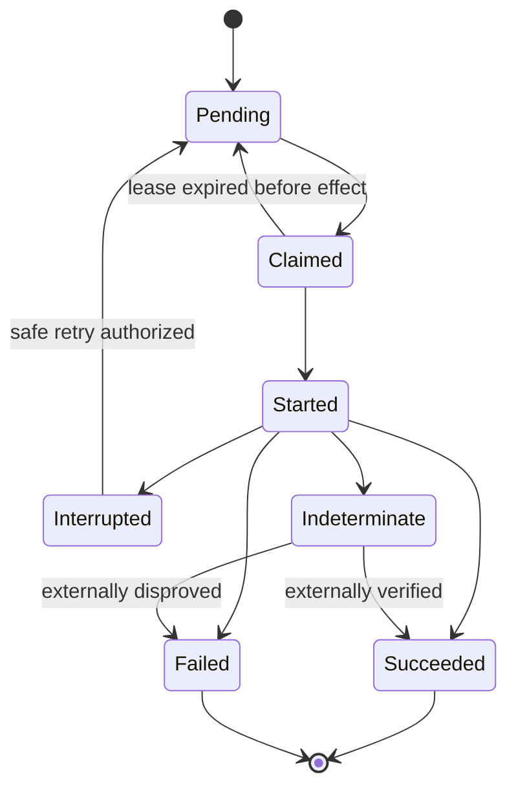

# Crash Consistency and Recovery

## 1. Purpose

SQLite, filesystem artifacts, Git, child processes, and cloud APIs cannot share
one atomic transaction. The system therefore persists intent, performs one
external side effect, records authoritative evidence, and reconciles incomplete
operations after restart.

The design favors an honest `indeterminate` result over unsafe retry or false
success.

## 2. Operation classes

Every side-effecting operation declares one class:

| Class | Definition | Automatic recovery |
|---|---|---|
| `idempotent` | Repetition with the same key has the same effect | May retry after policy, budget, and lease revalidation |
| `queryable` | External state can prove whether it completed | Query first; retry only when absence is authoritative |
| `non_repeatable` | Completion cannot be proved and repetition may duplicate or destroy | Never automatic; mark `indeterminate` |

Classification belongs to trusted code. An agent cannot label its own request
idempotent.

Examples:

- artifact content-addressed write: `idempotent`;
- conditional Git ref update: `queryable`;
- local build in a disposable worker: usually `idempotent` if output is isolated;
- package install or arbitrary script: often `non_repeatable`;
- cloud model request without provider idempotency/query API: cost-bearing and
  potentially `non_repeatable`.

## 3. Intent state machine

Rules:

- `Pending → Claimed` uses a SQLite compare-and-set lease;
- every claim has owner, expiry, attempt number, and current executor fencing
  token where applicable;
- the dispatcher records `Started` immediately before crossing the external
  boundary;
- retries create attempt records and never erase earlier evidence;
- only a trusted reconciler moves `Indeterminate` after authoritative evidence.

## 4. Event append transaction

For a state-changing application command:

1. `BEGIN IMMEDIATE`;
2. load stream head and compare expected version;
3. validate the domain transition;
4. insert immutable event rows;
5. update projections and `tasks.current_sequence`;
6. insert any operation intent/outbox rows;
7. commit;
8. publish UI notifications after commit.

If commit fails, no side effect is dispatched. UI state is derived from
committed projections/events, not optimistic frontend mutation.

## 5. Artifact protocol

Artifacts use a content-addressed object store.

### 5.1 Write sequence

1. Compute or declare expected SHA-256 and size.
2. In SQLite reserve artifact ID and insert `artifact_operations(status =
   'intent')`.
3. Write a unique staging file under the target artifact volume.
4. Flush file data and synchronize according to the platform implementation.
5. Re-read or stream-verify hash and size.
6. Atomically rename to `objects/<hash-prefix>/<hash>`.
7. In SQLite mark artifact metadata `available` and journal `completed`.

The final object name is deterministic. If the object already exists, its bytes
must verify before reuse.

### 5.2 Recovery table

| SQLite journal | Staging/object bytes | Action |
|---|---|---|
| No intent | Unrecognized staging file | Move to quarantine; delete only after retention window |
| `intent` | No bytes | Mark aborted or retry if operation is still required |
| `intent` | Valid staging file | Complete rename and metadata |
| `intent` | Valid final object | Complete metadata |
| `intent` | Invalid bytes | Quarantine and fail |
| `completed` | Valid object | Healthy |
| `completed` | Missing/invalid object | Mark artifact `missing`; block consumers; restore and reverify or fail |

Artifact consumers verify expected hash and availability before reading. A
`missing` artifact may return to `available` only after byte identity is
reverified. `quarantined` is terminal in place; recovered content is recorded as
a new artifact identity rather than reviving quarantined bytes.

## 6. Child-process protocol

1. Persist process operation intent with exact executable, argv, environment
   profile, cwd capability, network profile, limits, and policy/approval IDs.
2. Claim the intent.
3. Create the Job Object or equivalent containment boundary.
4. Spawn the process suspended when the platform adapter supports safe setup.
5. Attach containment and output pipes before allowing execution.
6. Record the authoritative process binding.
7. Mark `Started`.
8. Capture bounded output and exit status.
9. Persist result artifacts and terminal operation state.

Job configuration uses kill-on-close and disallows unintended breakaway. After
an application crash, the OS boundary should terminate the tree. Startup still
checks for surviving processes and never assumes termination solely from a
missing PID.

If a process may have produced external effects and no completion evidence
exists, apply its declared operation class. Do not rerun an arbitrary script
because the process record says `Started`.

## 7. Cloud-provider protocol

Before sending:

- reserve cost/token budget;
- persist exact redacted request digest and provider/model binding;
- persist the intent;
- evaluate current policy.

After sending:

- capture provider request/response IDs when available;
- distinguish provider-reported usage from core estimates;
- persist terminal content before acknowledging the agent run.

If the app crashes after request transmission but before response persistence:

- use a provider idempotency or status API when available;
- otherwise mark the attempt `indeterminate`;
- a retry requires explicit operation policy and may incur duplicate cost;
- never fabricate the lost response from stream fragments.

## 8. Worktree and Git operations

Worktree creation is `queryable`:

- persist repository identity, base commit, target branch, target path, and
  expected absence/presence;
- after restart query Git worktree metadata and filesystem state;
- adopt only an exact matching worktree;
- quarantine or require user action for conflicting paths/branches.

Final commit uses the protocol in
[Finalization and approval integrity](14-finalization-approval-integrity.md).
Conditional ref update makes completion queryable. Recovery never uses
destructive reset or force update.

## 9. Executor lease recovery

Lease state persists in SQLite, but process authority is enforced through
fencing:

1. startup marks old lease holder unavailable;
2. increment the task's fencing epoch before granting a new lease;
3. terminate or isolate surviving old workers;
4. reject queued requests containing older tokens;
5. reconcile workspace mutations before resuming.

Wall-clock expiry is not the sole correctness mechanism. Fencing tokens remain
valid across clock changes and are monotonically increasing integers.

## 10. Startup reconciliation order

Startup proceeds in this order:

1. acquire single-application recovery lock;
2. open SQLite and validate schema/integrity;
3. inspect update/migration journal;
4. validate artifact roots and free disk reserve;
5. reconcile artifact operations;
6. inspect open `retrieval_sessions` and sidecar/process traces;
7. rebuild or validate critical projections;
8. fence stale executor leases;
9. inspect Job Objects/process records and terminate unauthorized survivors;
10. reconcile Git repositories and worktrees;
11. reconcile external operation intents;
12. validate open approvals against current canonical inputs;
13. mark vector/graph indexes degraded until freshness checks complete;
14. expose task state to the UI;
15. release dispatch only after recovery completes.

For each retrieval row still `running`, the reconciler may record a proved
terminal outcome. If the outcome cannot be proved, it writes a task-scoped exact
trace artifact and sets `status = 'indeterminate'`; it never guesses success or
safe retry. An `indeterminate` row is retained and terminal; retry creates a new retrieval session linked through application trace metadata rather than rewriting the uncertain receipt.

Recovery actions are themselves events and operation records.

## 11. Backup, migration, and update

A pre-update backup includes:

- SQLite online backup created through the SQLite backup API;
- schema and application version;
- frozen artifact reachability manifest and hashes;
- policy/configuration snapshot;
- update journal and restore instructions.

Update strategy:

1. block new operations;
2. resolve or preserve indeterminate operations;
3. create and verify complete backup;
4. install signed binary;
5. run expand migration compatible with the prior binary;
6. start and perform health checks;
7. on failure, run the prior binary against the compatible schema or restore
   the complete backup;
8. run destructive contract migration only after rollback window closes.

Restoring only the SQLite file while leaving incompatible artifacts or policy
state is not a valid rollback.

## 12. Fault-injection matrix

Every boundary is tested before and after:

- event append;
- projection update;
- intent insert;
- intent claim;
- staging-file creation;
- artifact flush;
- artifact rename;
- artifact metadata completion;
- process spawn and containment attachment;
- provider request transmission;
- executor lease replacement;
- worktree creation;
- candidate-tree creation;
- approval persistence;
- commit object creation;
- conditional ref update;
- migration step and health check.

Test environments inject:

- process kill and machine restart simulation;
- disk full;
- access denied;
- file sharing violation and antivirus lock;
- SQLite busy/corruption scenarios;
- network timeout and partial response;
- clock movement;
- stale PID reuse;
- duplicate dispatcher delivery.

## 13. Recovery invariants

- no external side effect occurs before a committed intent;
- every incomplete intent is visible and reconcilable;
- no indeterminate non-repeatable operation retries automatically;
- event streams are immutable;
- projections can rebuild without external effects;
- artifact metadata never marks unverifiable bytes available;
- older fencing tokens never regain authority;
- unexpected Git refs or worktrees are preserved, not overwritten;
- update rollback restores a compatible whole state;
- recovery never reports success without authoritative evidence.

## 14. v3 intent/attempt evidence model

A logical operation intent answers *what effect is authorized*. An operation attempt answers *which dispatch crossed or may have crossed the external boundary*. Attempt number starts at one and increases exactly by one. At most one attempt is active.

Attempt identity fields are immutable. Boundary time, terminal time, result artifact, receipt artifact, and error artifact are set-once. A late completion may terminalize only its exact attempt and may update the aggregate only if that attempt remains current under compare-and-set.

For `non_repeatable`, a durable `started` attempt without proof of external absence becomes `indeterminate` and receives zero automatic retry. Cancellation after the effect commit point does not erase or relabel the receipt. Reconciliation preserves all conflicting observations and never chooses the latest row by convenience.
