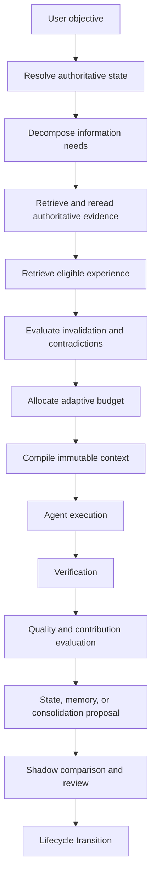

# Cognitive Memory and Agent Quality Contract v4.2

## 1. Status

v4.2 preserves the measured-utility and adversarial-hardening work from v4.1.1, then closes the remaining end-to-end workflow, wire/storage, benchmark-comparability, and actor-proof gaps. The bounded workflow and persistence paths described here are contract-ready and journey-tested; this does not prove runtime model quality, platform containment, or product adoption.

## 2. Goals

- resolve current state deterministically;
- retrieve the smallest sufficient authoritative evidence;
- use prior experience only when it is eligible and useful;
- prevent known repeated mistakes;
- measure contribution and token cost;
- learn only through evidence, shadow comparison, and review;
- retain complete provenance and authority history.

## 3. Non-goals

- autonomous memory promotion;
- unbounded memory accumulation;
- cross-project memory federation;
- vector similarity as truth;
- preference inference as high-authority state;
- production quality claims from schema validation.

## 4. Core capabilities

1. **Authoritative State Store** with fixed precedence, valid-time records, explicit conflict identities, and one immutable receipt per resolved conflict.
2. **Evidence Store** backed by repository source, artifacts, events, decisions, and tool receipts.
3. **Experience Memory Store** for episodes, semantic lessons, procedures, and negative memory.
4. **Typed invalidation** with unique rule identity, kind-valid payloads, scope applicability, and evaluation-time ordering before durable experience retrieval.
5. **Adaptive Context Compiler** driven by information needs, risk, coverage, and marginal utility.
6. **Isolated shadow promotion gate** bound to the exact experiment arm, candidate memory, and latest result for model-generated semantic, procedural, and negative memory.
7. **Contribution ledger** linked to the exact selected retrieval candidate and context item, plus rebuildable utility projections.
8. **Consolidation workflow** that retains all authority history.
9. **Controlled benchmark suite v3** with four experiment arms plus dedicated immutable run, result, comparison, and release-decision receipts.

## 5. End-to-end data flow

## 6. Authority rules

- active current state outranks historical experience;
- repository source outranks summaries and embeddings;
- retrieval output is a candidate set, not authority;
- model reflection cannot promote memory;
- similarity and utility cannot mutate lifecycle state;
- deterministic or policy approval of model-generated semantic, procedural, or negative memory requires the latest passing shadow evaluation bound to the exact candidate memory and benchmark arm; each origin classification is candidate-time, actor-binding-digest-bound, evidenced, and immutable;
- explicit user approval may override the shadow requirement and is retained as evidence;
- every v4.1.1 durable memory has uniquely identified executable invalidation rules, and retrieval uses only applicable evaluations observed no later than retrieval;
- stale memory is replaced by a new immutable version, never reactivated in place;
- durable memory enters context only through its exact selected retrieval candidate;
- consolidation retains all input records, and unsupported split actions remain deferred.

## 7. Compatibility strategy

- `cognitive-memory.v4.schema.json` is the normative cognitive wire contract;
- `sqlite-v6.sql` is the normative clean-install schema, and `migrate-v5-to-v6.sql` is the exact v4.1.1 upgrade path;
- `benchmark-suite.v3.schema.json` plus the run, case-result, comparison-report, and quality-release-decision schemas are normative for controlled comparisons;
- `workflow-transitions.v2.json`, `actor-binding.v1.schema.json`, and `credential-challenge.v1.schema.json` are part of the same authority set;
- v4.1.1 (`cognitive-memory.v3`, `sqlite-v5`, benchmark v2, workflow v1) and older contracts remain immutable migration and regression inputs only;
- protocol-v2 agents without cognitive extensions still receive compiled context but cannot emit structured cognitive receipts.

## 8. Quality proof requirement

A quality claim requires the experiment arms `control_no_memory`, `compaction_only`, `evidence_retrieval`, and `evidence_plus_experience`. It also requires:

- a locked representative benchmark corpus;
- all four controlled experiment arms;
- equal controlled model, evaluator, repository revision, fixture, objective, policy, tool-permission, acceptance-rule, and budget inputs;
- every intentional retrieval/context/memory treatment difference explicitly declared;
- repeated runs sufficient to expose variance;
- per-case correctness and regression reporting;
- contribution and token-cost analysis;
- zero cross-scope leakage;
- no regression in unsupported claims or stale-memory use.

Initial release targets remain hypotheses until measured:

- at least 20% relative reduction in repeated known-error rate;
- at least 10% relative improvement in first-pass verifier acceptance;
- unsupported-claim rate no worse than control;
- stale-memory use below 0.5% of retrieved durable items;
- cross-project leakage equal to zero;
- context compilation within the configured local p95 budget.

## 9. MVP principle

Build the smallest slice that can falsify the memory hypothesis:

1. state resolution;
2. evidence retrieval;
3. negative and procedural memory;
4. typed invalidation;
5. contribution events;
6. benchmark arms.

Do not build broad semantic extraction, autonomous consolidation, or remote retrieval until controlled evidence shows that the smaller slice improves outcomes.

## 10. v4.2 contract correction

v4.2 replaces the v4.1.1 wire/storage ambiguity without rewriting historical
records:

- `cognitive-memory.v4.schema.json` requires an explicit `logicalKey` on every
  memory proposal;
- preference `subject` remains a top-level canonical wire field;
- canonical applicability is persisted unchanged in
  `memory_wire_contracts_v2` and subject identity is persisted in
  `memory_subject_bindings`;
- the legacy `memory_records.applicability_json` representation is a retained
  compatibility projection, not the DTO round-trip authority;
- a memory cannot transition from candidate to verified without its canonical
  v4 wire binding, and a preference also requires its explicit subject binding;
- retrieval result status `indeterminate` is serializable only with a recovery
  receipt, the last durable trace artifact, an uncertainty reason, and no
  candidate set that could be mistaken for authoritative output.

Controlled quality comparison uses the dedicated benchmark v3/run/result/
comparison/release schemas. Equal controls are checked field-by-field, while
retrieval pipeline, context compiler, and memory policy are declared treatment
dimensions. Schema conformance still does not prove runtime benefit.
