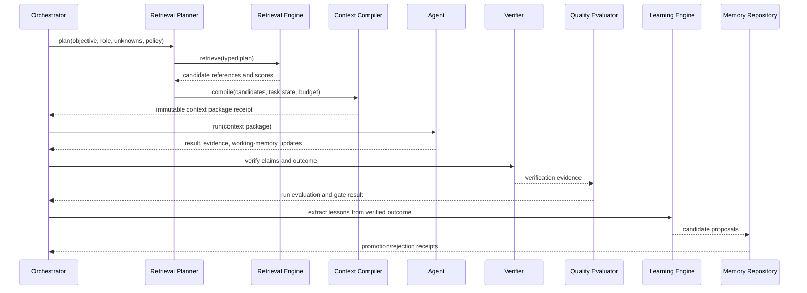

# Cognitive Memory and Agent Quality Revamp

## 1. Status

This document is normative for v4.0. It defines the cross-cutting replacement of the previous static retrieval model with a verified cognitive lifecycle. Detailed context and memory behavior is specified in [Cognitive Context and Memory Architecture](../../../04-context-memory.md).

## 2. Goals

1. Reduce repeated agent errors by retrieving verified negative and episodic memory.
2. Improve first-pass correctness through role-aware hybrid retrieval and context compilation.
3. Make assumptions, unknowns, contradictions, and evidence visible and auditable.
4. Learn from verified outcomes without allowing agents to poison long-term memory.
5. Measure quality improvements against a reproducible benchmark baseline.
6. Keep authority, policy, audit, and recovery independent from any retrieval engine.

## 3. Non-goals

- storing every conversation forever;
- granting agents autonomous long-term memory writes;
- treating vector similarity or model agreement as verification;
- replacing SQLite authority storage with a vector or graph database;
- promising deterministic model outputs;
- building a general human-like cognitive architecture unrelated to engineering tasks.

## 4. System capabilities

The revamp adds seven application capabilities:

| Capability | Responsibility |
|---|---|
| Memory Kernel | Versioned memory taxonomy, lifecycle, evidence, and scope |
| Retrieval Planner | Chooses retrieval methods and evidence targets by objective and role |
| Hybrid Retrieval Engine | Produces non-authoritative ranked candidate references |
| Context Compiler | Builds immutable role-specific context packages and supplements |
| Working Memory Manager | Tracks facts, inferences, unknowns, hypotheses, and next actions |
| Learning Engine | Converts verified outcomes into reviewable memory proposals |
| Quality Evaluator | Scores runs and enforces role-specific quality gates |

## 5. End-to-end data flow

## 6. Authority rules

- Retrieval engines and indexes are disposable projections.
- Memory content is authoritative only after required verification and activation.
- Context packages are immutable disclosure receipts. A package manifest references a separate effective model-input artifact; `contentHash` hashes those effective bytes, never the manifest that contains the hash.
- A context package is bound to exactly one preallocated agent run and cannot be reused by another run.
- Working memory is recoverable state but not verified knowledge.
- Evaluation records are immutable evidence and cannot be overwritten to improve a score.
- A memory version that becomes `stale` is terminal for activation. Reuse requires a new candidate version with fresh evidence and review, linked through `supersedes`.
- User correction supersedes model-generated interpretation when both address the same user preference or acceptance decision.

## 7. Compatibility strategy

v4.0 preserves existing task phases and the Open Agent Protocol v2 core. Cognitive methods are a capability-negotiated extension. Agents without the extension still receive compiled context and can complete tasks; they simply cannot request progressive context or emit structured working-memory feedback.

The default embedded implementation remains local-first:

- SQLite authority and FTS;
- application-owned repository graph projection;
- embedded vector index behind `RetrievalEngine`;
- optional local reranker;
- filesystem Artifact Store.

Sidecar and remote engines are optional adapters that must pass the same conformance suite.

## 8. Quality proof requirement

The v4.0 revamp is complete only when:

- a locked benchmark corpus exists;
- v3.2 baseline runs are recorded;
- v4.0 runs use the same tasks, repository revisions, budgets, and acceptance rules;
- primary quality metrics improve without violating security or reliability gates;
- regressions are listed rather than hidden by an aggregate score.

Primary acceptance targets for the first release candidate:

- at least 20% relative reduction in repeated known-error rate;
- at least 10% relative improvement in first-pass verifier acceptance;
- unsupported-claim rate no worse than baseline;
- stale-memory use below 0.5% of retrieved active items;
- cross-project memory leakage equal to zero;
- p95 initial context compilation within the configured local performance budget.

Targets are release criteria, not claims that the unimplemented design already achieves them.

## 9. Migration principle

Migration is a re-index and controlled backfill, not a blind import of vector scores or inferred graph state. Existing verified memory becomes versioned semantic memory after evidence revalidation. Existing summaries remain non-authoritative unless independently verified.

See [v3.2 to v4.0 migration contract](../../../26-v3.2-to-v4-migration-contract.md).
